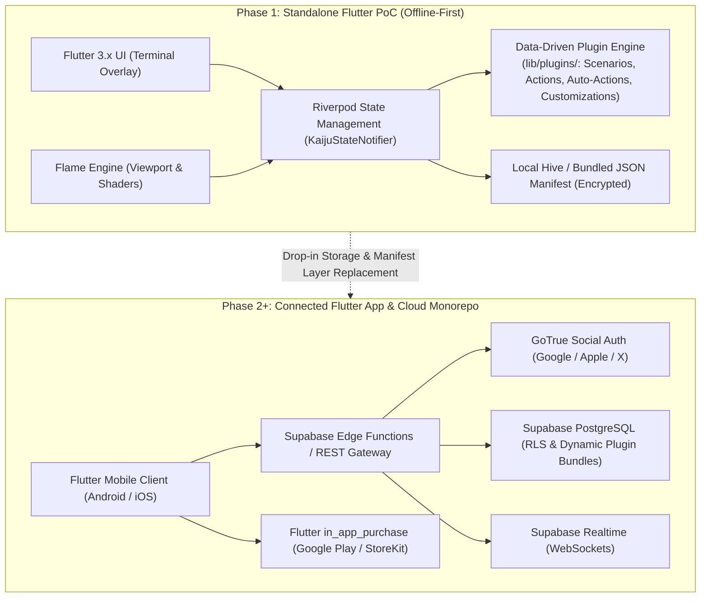

# Architecture: 01 System Overview

This document presents the overarching architectural design of the **Unix Tamagotchi** platform, built **100% in Flutter (Dart 3.x)** and the **Flame engine**, covering its evolution from an offline-first Proof of Concept (PoC) to a scalable, real-time multi-platform monorepo with a **100% Data-Driven Plugin Engine**.

---

## Architecture Evolution

---

## High-Level Component Architecture

### 1. Flutter Mobile Client (`apps/mobile` or `tamagotchi_app/`)
- **Presentation Layer**: Two-layer compositing architecture:
  - **Kaiju Scene Layer (Flame Viewport)**: 1-bit dithered bitmap sprites rendered at low virtual resolution (taking visual reference from `Desing References/Godzila.webp`). Applies dithering shader via Flame `FragmentProgram` and upscales with nearest-neighbor filtering.
  - **UI Layer (Flutter Overlay)**: Native resolution monospace terminal text, bracket-style buttons, hazard stripe decorations, and system diagnostic labels.
- **Engine Core & Riverpod**:
  - `KaijuStateNotifier`: Orchestrates Kaiju interactions, stat balance (3 core stats in PoC; extended stats in Phase 3+), and cooldown timers.
  - `PluginRegistry`: Data-driven registry that loads plugin bundles (scenarios, user actions, autonomous actions, and customizations like furniture and clothing) from local JSON in PoC and from the Supabase backend in Phase 2+.
  - `Flame Game Component`: Manages sprite animation, dynamic scenario/customization layer compositing, particle effects, and the Bayer matrix fragment shader pipeline.
  - `InventoryNotifier`: Manages owned Kaijus (unlimited capacity) and the 240 starting credits.
- **Data Persistence**: Local key-value binary engine (**Hive** or encrypted SharedPreferences) maintaining zero-latency reads/writes without an active network connection.

### 2. Data-Driven Plugin Subsystem (`lib/plugins/`)
Everything in the frontend plugin layer is **generic and data-driven** so that the product team can create new events, scenarios, actions, or customizations from the backend without modifying client code:
- `plugins/models/`: Data models for `PluginBundle`, `ScenarioPluginConfig`, `ActionPluginConfig`, and `CustomizationPluginConfig`.
- `plugins/executors/`:
  - `generic_user_action_executor.dart`: Evaluates prerequisites (energy, age, required furniture) and applies stat/credit deltas for user-initiated actions (e.g. Eat a ball of humans, Sleep, Play, Crush Tanks).
  - `generic_autonomous_evaluator.dart`: Evaluates condition/schedule-triggered routines (e.g. City rampage work shifts, urban demolition study, clinic recovery).
  - `generic_scenario_builder.dart`: Dynamically constructs Flame scene graphs from JSON layer/sprite definitions (e.g. Terminal Habitat Room, Metropolis Ruins, Clinic Ward).
  - `generic_customization_renderer.dart`: Applies furniture placements, Kaiju clothing/accessory sprite layers, and room palette shader uniforms defined by customization plugins.

### 3. Backend & Cloud Services (`backend/` & Supabase)
- **Database & Row-Level Security**: Supabase PostgreSQL housing player profiles, groups (`SOLO`, `COUPLE`, `FRIENDS`), kaiju inventories, transactions, and the `plugins`, `action_plugins`, `scenario_plugins`, and `customization_plugins` tables.
- **Authentication**: Social OAuth with Google Identity, Sign in with Apple, and Twitter (X).
- **Real-Time Engine**: WebSocket channels for remote action broadcasting, presence, and live multiplayer shared care for couples and friend groups.
- **In-App Purchase Webhook Handler**: Validates Google Play Real-Time Developer Notifications (RTDN) and Apple App Store Server Notifications V2 before crediting user accounts.

> [!NOTE]
> **Humor & Lore Note:** The contrast of a giant kaiju living in a normal containment room, sitting at a desk to study urban demolition, and getting hungry like a regular tamagotchi is an explicit design choice. This absurdity is central to the game's charm.