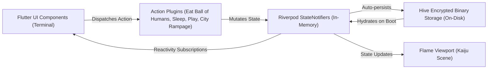

# Architecture: 06 Offline-First State Management (Flutter Riverpod)

This document defines the client-side state management architecture for the **Unix Tamagotchi**, explaining how the application functions 100% offline for the Initial Proof of Concept (PoC) using **Flutter Riverpod** and **Hive**.

---

## 1. PoC State Architecture (Riverpod + Hive)

For the PoC, all application state resides on the user's device. We utilize **Flutter Riverpod** paired with **Hive** for instant, binary-level read/write persistence across app restarts.



---

## 2. Dart State Models (`lib/models/kaiju_state.dart`)

```dart
import 'package:flutter/foundation.dart';

@immutable
class KaijuInstance {
  final String id;
  final String groupId; // maps to groups.id; 'solo_<userId>' during PoC offline phase
  final String kaijuType; // 'godzilla' | 'cyber_godzilla'
  final String nickname;
  final int hunger;     // 0 - 100 (PoC core stat)
  final int energy;     // 0 - 100 (PoC core stat)
  final int happiness;  // 0 - 100 (PoC core stat)
  final Map<String, int> extendedStats; // Post-PoC stats: intel, comfort, hydration, hp, lume
  final Map<String, bool> statusFlags;  // Milestone 1.2+: is_exhausted; Phase 3+: is_sick
  final int ageInDays;
  final String currentActionState; // 'idle' | 'eating' | 'sleeping' | 'playing' | 'destroying_city'
  final String activeScenarioId;   // e.g. 'default_room' | 'metropolis_ruins'
  final DateTime lastInteractionTimestamp;

  const KaijuInstance({
    required this.id,
    required this.groupId,
    required this.kaijuType,
    required this.nickname,
    this.hunger = 80,
    this.energy = 80,
    this.happiness = 80,
    this.extendedStats = const {},
    this.statusFlags = const {},
    this.ageInDays = 0,
    this.currentActionState = 'idle',
    this.activeScenarioId = 'default_room',
    required this.lastInteractionTimestamp,
  });

  KaijuInstance copyWith({
    int? hunger,
    int? energy,
    int? happiness,
    Map<String, int>? extendedStats,
    Map<String, bool>? statusFlags,
    int? ageInDays,
    String? currentActionState,
    String? activeScenarioId,
    DateTime? lastInteractionTimestamp,
  }) {
    return KaijuInstance(
      id: id,
      groupId: groupId,
      kaijuType: kaijuType,
      nickname: nickname,
      hunger: hunger ?? this.hunger,
      energy: energy ?? this.energy,
      happiness: happiness ?? this.happiness,
      extendedStats: extendedStats ?? this.extendedStats,
      statusFlags: statusFlags ?? this.statusFlags,
      ageInDays: ageInDays ?? this.ageInDays,
      currentActionState: currentActionState ?? this.currentActionState,
      activeScenarioId: activeScenarioId ?? this.activeScenarioId,
      lastInteractionTimestamp: lastInteractionTimestamp ?? this.lastInteractionTimestamp,
    );
  }
}
```

---

## 3. Riverpod State Notifier Implementation (`lib/state/kaiju_state_notifier.dart`)

```dart
import 'package:flutter_riverpod/flutter_riverpod.dart';
import '../models/kaiju_state.dart';
import '../plugins/models/action_plugin_config.dart';
import '../plugins/executors/generic_user_action_executor.dart';

class GameState {
  final int credits;
  final List<KaijuInstance> ownedKaijus;
  final String? activeKaijuId; // Synced per-group in Phase 4 multiplayer

  const GameState({
    required this.credits,
    required this.ownedKaijus,
    this.activeKaijuId,
  });

  KaijuInstance? get activeKaiju {
    if (activeKaijuId == null || ownedKaijus.isEmpty) return null;
    return ownedKaijus.firstWhere(
      (k) => k.id == activeKaijuId,
      orElse: () => ownedKaijus.first,
    );
  }
}

class KaijuStateNotifier extends StateNotifier<GameState> {
  KaijuStateNotifier()
      : super(const GameState(
          credits: 240, // Starting PoC balance
          ownedKaijus: [],
          activeKaijuId: null,
        ));

  /// Purchase a kaiju: Dynamic capacity (no hardcoded 2-kaiju limit)
  bool buyKaiju({
    required String kaijuType,
    required String nickname,
    required int price,
    String groupId = 'solo_local',
  }) {
    if (state.credits < price) {
      return false; // Insufficient credits
    }

    final newKaiju = KaijuInstance(
      id: 'kaiju_${DateTime.now().millisecondsSinceEpoch}',
      groupId: groupId,
      kaijuType: kaijuType,
      nickname: nickname,
      lastInteractionTimestamp: DateTime.now(),
    );

    state = GameState(
      credits: state.credits - price,
      ownedKaijus: [...state.ownedKaijus, newKaiju],
      activeKaijuId: state.activeKaijuId ?? newKaiju.id,
    );

    return true;
  }

  void switchActiveKaiju(String kaijuId) {
    if (state.ownedKaijus.any((k) => k.id == kaijuId)) {
      state = GameState(
        credits: state.credits,
        ownedKaijus: state.ownedKaijus,
        activeKaijuId: kaijuId,
      );
    }
  }

  /// Executes a data-driven Action Plugin configuration dynamically
  void executePluginAction(ActionPluginConfig actionConfig) {
    final kaiju = state.activeKaiju;
    if (kaiju == null) return;

    final result = GenericUserActionExecutor.execute(
      currentKaiju: kaiju,
      config: actionConfig,
      triggeredAt: DateTime.now(),
    );

    if (!result.success) return;

    // Apply stat deltas
    final updatedKaiju = kaiju.copyWith(
      hunger: (kaiju.hunger + result.hungerDelta).clamp(0, 100),
      energy: (kaiju.energy + result.energyDelta).clamp(0, 100),
      happiness: (kaiju.happiness + result.happinessDelta).clamp(0, 100),
      currentActionState: result.animationSequence,
      activeScenarioId: result.targetScenarioId,
      lastInteractionTimestamp: DateTime.now(),
    );

    state = GameState(
      credits: state.credits + result.creditsEarned,
      ownedKaijus: state.ownedKaijus.map((k) => k.id == kaiju.id ? updatedKaiju : k).toList(),
      activeKaijuId: state.activeKaijuId,
    );

    // Reset action state to idle after duration
    Future.delayed(result.duration, () {
      final current = state.activeKaiju;
      if (current != null && current.id == updatedKaiju.id) {
        final resetKaiju = current.copyWith(currentActionState: 'idle');
        state = GameState(
          credits: state.credits,
          ownedKaijus: state.ownedKaijus.map((k) => k.id == current.id ? resetKaiju : k).toList(),
          activeKaijuId: state.activeKaijuId,
        );
      }
    });
  }
}

final gameStateProvider = StateNotifierProvider<KaijuStateNotifier, GameState>((ref) {
  return KaijuStateNotifier();
});
```
