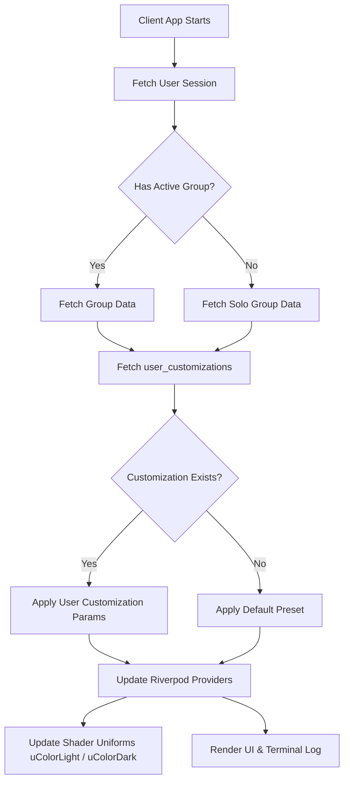

# Customization: 01 Customization System Overview

The Unix Tamagotchi features a robust customization system designed around its 1-bit dithered, industrial terminal aesthetic. This document outlines the scope, architecture, and user interface for cosmetic customizations.

## 1. Customizable Elements (Plugin-Driven)

All customizable items and presets in the Tactical 1-Bit Cyber-Specimen OS are managed as **Customization Plugins** (`customization_plugins` table) so the product team can dynamically add new furniture, clothing, skins, or palettes for seasonal events without modifying the client codebase:

1. **Room Palette Themes (`PALETTE`):** Swaps the dithering shader's `uColorLight` and `uColorDark` uniforms and terminal UI tokens.
   - *Examples:* 'Classic Khaki' (matching `Desing References/Godzila.webp`), 'Amber Monitor', 'Game Boy Green', 'Blue Terminal'.
2. **Kaiju Designations:** Custom specimen names (e.g. `CRAZY_DIAMOND_PULSE`, `GODZILLA_01`).
3. **Terminal Boot Messages (`BOOT_MESSAGE`):** Custom welcome text displayed in the log panel upon startup.
4. **Habitat Furniture (`FURNITURE` — Phase 2+):** Functional room furnishings (beds, desktop & chair workstations, couches, kitchens, lamps) placed in the shared habitat room (`Furniture/01..03`).
5. **Kaiju Clothing & Accessories (`CLOTHING` / `SKIN` — Phase 2+):** 1-bit dithered sprite overlays (hats, mech visors, capes, alternative skins) layered onto the Kaiju sprite at `priority = 50` by `GenericCustomizationRenderer`.
6. **Room Ambient Effects (Phase 2+):** Shader parameters controlling fog density, scan lines, and CRT curvature.

### 1.1 PoC Scope (Milestone 1.1)
For the initial Proof of Concept (PoC), the following elements are in scope:
- Room Palette Themes (`PALETTE`)
- Kaiju Designations (Auto-generated at adoption; read-only in PoC)
- Terminal Boot Messages (`BOOT_MESSAGE`)

**Deferred to post-PoC:** Habitat Furniture (`FURNITURE`), Kaiju Clothing/Accessories (`CLOTHING`), Kaiju Skins (`SKIN`), Manual Rename (`PATCH /kaijus/{id}/name`), and Room Ambient Effects.

## 2. Per-User vs. Shared Group Rendering in Multiplayer

In a multiplayer group setting (`COUPLE` or `FRIENDS`):

- **Per-User Customizations (Palettes, Boot Messages):** Each member sees their *own* terminal display preferences. For example, User A might view the specimen in 'Amber Monitor' mode, while User B simultaneously views the same specimen in 'Game Boy Green'.
- **Shared Group Customizations (Nicknames, Habitat Furniture, Kaiju Clothing):** Kaiju nicknames, placed room furniture, and equipped Kaiju clothing/accessories are synchronized globally within the group; all members see the exact same furnished room, dressed Kaiju, and nickname.

## 3. Customization Selector UI

The customization interface maintains the industrial terminal aesthetic, utilizing VT323 monospace font and hazard caution stripes where applicable, using bracket-style buttons `[ ACTION ]`.

```text
=================================================
// SYSTEM.CUSTOMIZATION_MODULE_v1.0.4
=================================================

> SELECT_THEME:
  [X] CLASSIC_KHAKI (DEFAULT)
  [ ] AMBER_MONITOR
  [ ] GAME_BOY_GREEN
  [ ] BLUE_TERMINAL

> CONFIGURE_BOOT_SEQUENCE:
  MSG: "WAKE UP, NEO..."           [ EDIT ]

> SPECIMEN_DESIGNATION:
  ID: "CRAZY_DIAMOND_PULSE"        [ RENAME ]

=================================================
[ APPLY_CHANGES ]    [ REVERT_TO_DEFAULT ]
=================================================
```

## 4. Customization Data Flow

The following flow illustrates how customizations are fetched and applied on the client.


