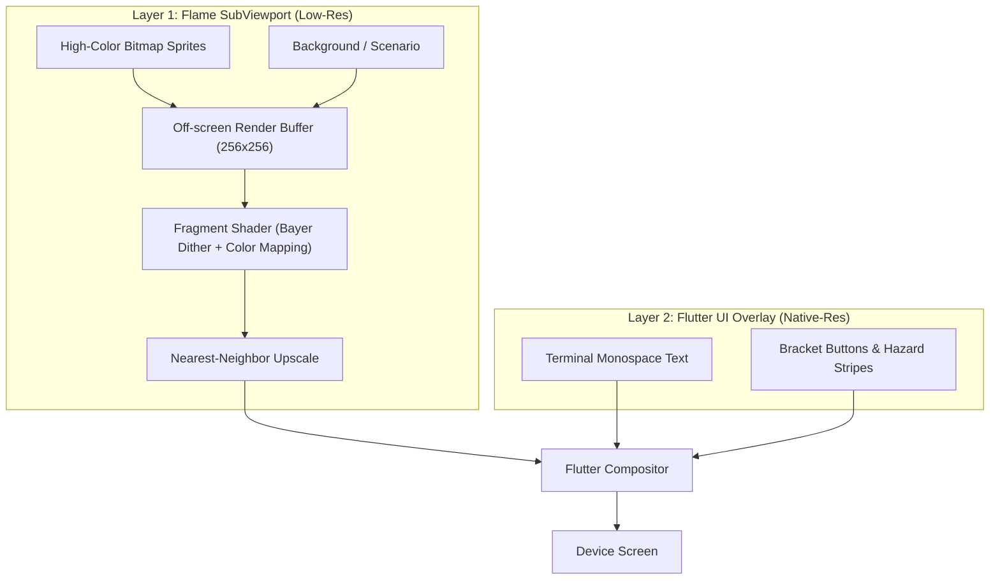

# Design: 06 1-Bit Ditherering Rendering Pipeline

This document details the graphics rendering pipeline for the **Unix Tamagotchi**, focusing on how high-resolution UI and low-resolution 1-bit dithered pixel art are combined using Flame, fragment shaders, and Flutter's compositing engine.

---

## 1. Architectural Overview: Two-Layer Compositing

To achieve the "Tactical 1-Bit Cyber-Specimen OS" aesthetic without sacrificing UI legibility, the app uses a strict two-layer compositing architecture:

1. **Layer 1: The Kaiju Scene (SubViewport)**
   - Managed by Flame.
   - Sprites (Kaijus, city ruins, habitat props) and backgrounds are rendered into an off-screen buffer at a very low virtual resolution (e.g., 256×256).
   - A custom Fragment Shader (GLSL/FLSL) is applied to this buffer to perform Ordered Bayer Dithering. The visual standard is defined by `Desing References/Godzila.webp`, where Godzilla's saurian silhouette, dorsal plates, and atomic breath beam render crisply through the 1-bit dither matrix.
   - The result is then upscaled to the device screen size using **Nearest-Neighbor** filtering to ensure crisp, chunky pixels.
2. **Layer 2: The Flutter UI Overlay**
   - Managed by Flutter's standard widget tree.
   - Renders exactly at native device resolution.
   - Handles crisp monospace typography, terminal borders, and user interactions.



---

## 2. Mathematical Foundation: Ordered Bayer Dithering

Why Ordered Dithering? We chose **Ordered Bayer Matrix Dithering** over error-diffusion algorithms like Floyd-Steinberg because ordered dithering is purely a screen-space operation. It can be executed entirely in parallel within a fragment shader, making it extremely highly performant on mobile GPUs.

### The Formula
For a given Bayer matrix $M$ of size $N \times N$, the normalized threshold for a pixel at screen coordinate $(x, y)$ is:

$$ threshold = \frac{M_N(x \bmod N, y \bmod N)}{N^2} $$

The pixel color is then determined by comparing its original luminance to this threshold:

$$ Color = \begin{cases} Color_{light} & \text{if } Luminance > threshold \\ Color_{dark} & \text{otherwise} \end{cases} $$

### Screen-Space vs Sprite-Space UVs
Crucially, the modulo operation $(x \bmod N, y \bmod N)$ is calculated using **screen-space coordinates**, not sprite-space UVs. This ensures that as sprites move or animate across the screen, they "swim" through a fixed screen-space checkerboard pattern, maintaining the structural illusion of a physical LCD matrix.

---

## 3. Shader Implementation (GLSL / FLSL — Impeller AOT Compatible)

The dithering is handled via a Flutter Fragment Shader (`assets/shaders/bayer_dither.frag`) registered under `flutter.shaders` in `pubspec.yaml`.

> **Impeller Compatibility Note**: To guarantee AOT compilation across both Vulkan/Metal Impeller and Skia backends without dynamic array-indexing restrictions, the 4×4 Bayer threshold is resolved via a helper function (`bayer4x4`) and supports a runtime `uLuminanceBias` uniform driven by the `OS_LUMINANCE` diagnostic control in `04:CONF`.

```glsl
#version 460 core
#include <flutter/runtime_effect.glsl>

uniform vec2 uResolution;      // floats 0, 1
uniform vec4 uColorLight;      // floats 2, 3, 4, 5 (e.g., Khaki Background #C5BEAA)
uniform vec4 uColorDark;       // floats 6, 7, 8, 9 (e.g., Charcoal Ink #141512)
uniform float uLuminanceBias;  // float 10 (range -0.35 to +0.35, default 0.0)
uniform sampler2D uTexture;    // sampler 0

out vec4 fragColor;

float bayer4x4(ivec2 p) {
    int x = p.x & 3;
    int y = p.y & 3;
    int index = y * 4 + x;
    if (index == 0)  return 0.0 / 16.0;
    if (index == 1)  return 8.0 / 16.0;
    if (index == 2)  return 2.0 / 16.0;
    if (index == 3)  return 10.0 / 16.0;
    if (index == 4)  return 12.0 / 16.0;
    if (index == 5)  return 4.0 / 16.0;
    if (index == 6)  return 14.0 / 16.0;
    if (index == 7)  return 6.0 / 16.0;
    if (index == 8)  return 3.0 / 16.0;
    if (index == 9)  return 11.0 / 16.0;
    if (index == 10) return 1.0 / 16.0;
    if (index == 11) return 9.0 / 16.0;
    if (index == 12) return 15.0 / 16.0;
    if (index == 13) return 7.0 / 16.0;
    if (index == 14) return 13.0 / 16.0;
    return 5.0 / 16.0;
}

void main() {
    vec2 fragCoord = FlutterFragCoord().xy;
    vec2 uv = fragCoord / uResolution;
    vec4 texColor = texture(uTexture, uv);

    // Ignore transparent pixels so background shows through cleanly
    if (texColor.a < 0.1) {
        fragColor = uColorLight;
        return;
    }

    // Calculate luminance with optional OS_LUMINANCE bias
    float luminance = clamp(
        dot(texColor.rgb, vec3(0.299, 0.587, 0.114)) + uLuminanceBias,
        0.0,
        1.0
    );

    // Screen-space pixel coordinates mapped to virtual 256x256 grid
    ivec2 virtualPixel = ivec2(floor(uv * 256.0));
    float threshold = bayer4x4(virtualPixel);

    // Apply 1-bit thresholding and map to active palette uniforms
    if (luminance > threshold) {
        fragColor = uColorLight;
    } else {
        fragColor = uColorDark;
    }
}
```

---

## 4. Off-Screen Render-to-Texture & Flame Integration

To composite the Flame `GameWidget` through `bayer_dither.frag` with crisp nearest-neighbor upscaling:

1. **Load the Shader**: Use `FragmentProgram.fromAsset('assets/shaders/bayer_dither.frag')` to load the AOT-compiled shader.
2. **Capture Off-Screen Texture (`uTexture`)**: A `RenderProxyBox` (`DitherShaderRenderObject` inside `DitheredViewport`) paints its child (`RepaintBoundary` wrapping the Flame `GameWidget`) into an `OffsetLayer` and rasterizes it via `layer.toImageSync(Offset.zero & size)` (or a `256×256` virtual canvas buffer).
3. **Bind Sampler & Uniforms**: Bind the captured `ui.Image` using `_shader.setImageSampler(0, capturedImage)` and set float indices `0..10` (`uResolution`, `uColorLight`, `uColorDark`, `uLuminanceBias`) from the active `AppPalette` and `SettingsState`.
4. **Nearest-Neighbor Upscaling**: All sprite and texture draws use `FilterQuality.none` so the 256×256 virtual pixel grid stays razor-sharp on high-DPI mobile displays.

```dart
// Inside DitherShaderRenderObject.paint(PaintingContext context, Offset offset):
final image = offsetLayer.toImageSync(Offset.zero & size);
shader
  ..setFloat(0, size.width)
  ..setFloat(1, size.height)
  ..setFloat(2, lightColor.red / 255.0)
  ..setFloat(3, lightColor.green / 255.0)
  ..setFloat(4, lightColor.blue / 255.0)
  ..setFloat(5, 1.0)
  ..setFloat(6, darkColor.red / 255.0)
  ..setFloat(7, darkColor.green / 255.0)
  ..setFloat(8, darkColor.blue / 255.0)
  ..setFloat(9, 1.0)
  ..setFloat(10, luminanceBias)
  ..setImageSampler(0, image);

final paint = Paint()
  ..shader = shader
  ..filterQuality = FilterQuality.none;
context.canvas.drawRect(offset & size, paint);
image.dispose();
```
