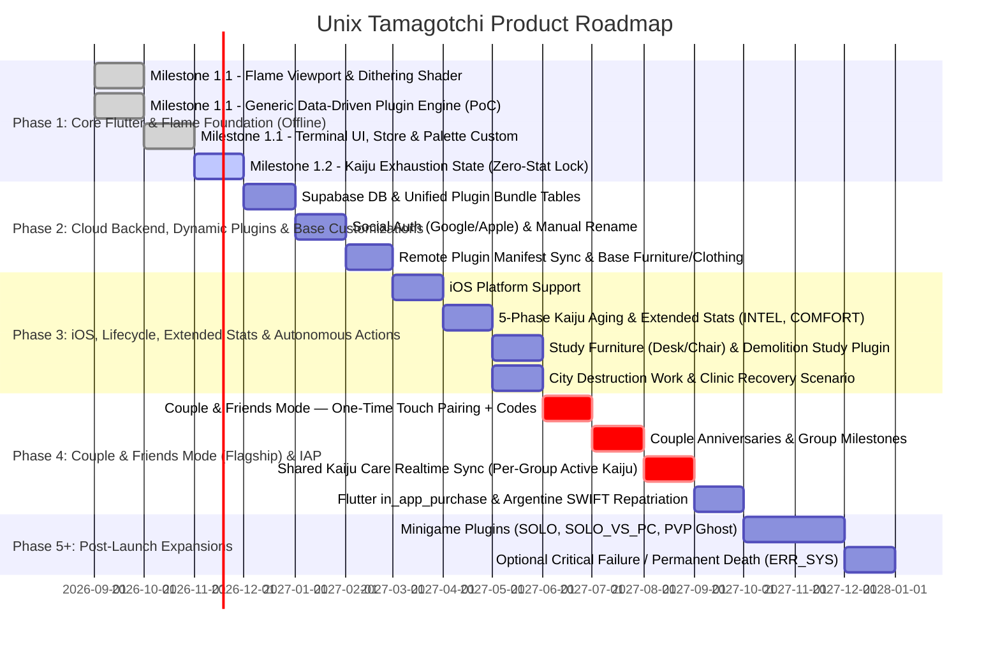

# Features: 04 PoC Scope and Future Roadmap

This document establishes the strict boundaries of the Initial Proof of Concept (PoC) versus the multi-phase product roadmap for the **Unix Tamagotchi**.

---

## 1. Scope Boundary Matrix

| Feature Domain | Included in Initial PoC (Milestone 1.1) | Deferred to Post-PoC Phases | Rationale |
| :--- | :---: | :---: | :--- |
| **Framework** | 🟢 **Flutter + Flame Engine** | — | Single codebase prevents costly migrations; Flame drives kaiju viewport. |
| **Plugin Subsystem** | 🟢 **100% generic data-driven frontend engine reading bundled PoC JSON manifest (`eat`, `sleep`, `play`, `default_room`, palettes)** | 🟡 **Phase 2+**: Remote backend plugin bundles (scenarios, actions, auto-actions, customizations) | Frontend is purely data-driven from Day 1 so product team can add events/features in Phase 2+ with zero code changes. |
| **Backend & Cloud** | 🔴 100% Offline (Local Hive) | 🟢 **Phase 2+**: Supabase PostgreSQL, Storage & Realtime | Zero cloud infrastructure required on Day 1. |
| **Kaiju Stats** | 🟢 **3 Core Stats only (`Hunger`, `Energy`, `Happiness`)** | 🟢 **Phase 3+**: Extended stats (`INTEL`, `COMFORT`, `HYDRATION`, `HP`, `LUME`) | Extra stats ship only when their paired actions and furniture are implemented. |
| **Failure / Recovery States** | 🔴 **None (Stats clamp at 0)** | 🟡 **Milestone 1.2**: Exhaustion state 🟢 **Phase 3**: Clinic Recovery (`hospital_recovery`) 🔴 **Phase 5+**: Permanent Death (`ERR_SYS`, pushed as late as possible) | Keeps initial PoC stress-free while progressively introducing stakes. |
| **Kaiju Capacity** | 🟢 **Unbounded (Credit-bound only — no server quota)** | — | Players may own as many kaijus as their credits allow. No backend limit field exists. |
| **Starting Economy** | 🟢 Fixed 240 Credits | 🟡 **Phase 3**: Autonomous work payouts 🟢 **Phase 4**: In-App Purchases | Pre-calculates exact initial acquisition testing. |
| **Core Actions** | 🟢 Eat, Sleep, Play (Data-driven plugins) | 🟡 **Phase 2+**: Event actions (`Crush Tanks`) 🟢 **Phase 3**: `Demolition Study`, `City Rampage` shifts | Core loop proven with zero friction. |
| **Scenarios** | 🟢 Default Room Scenario | 🟡 **Phase 2/3+**: Metropolis Ruins, Clinic Recovery Ward | Proves generic scenario layer rendering. |
| **Kaiju Lifecycle** | 🟡 **Static UI teaser with mock data (`EVO_MGR` screen)** | 🟢 **Phase 3**: 5-phase Aging, Autonomous Work & Study, Illness logic | Keeps early state models minimal. |
| **Visual System** | 🟢 1-Bit Dithered Visual System | 🟡 Additional stippling effects | Proves the core dithering and terminal UI aesthetics. |
| **Social & Multiplayer** | 🔴 Solo play only | 🟢 **Phase 4**: Collaborative Multiplayer Care for **Couples (`COUPLE`) & Friends (`FRIENDS`)** | Flagship selling point launched in Phase 4 with one-time phone-touch pairing + single-use invite code fallback. |
| **Furniture & Habitat** | 🔴 **Excluded** | 🟢 **Phase 2**: Base furniture (for 3 core stats) 🟢 **Phase 3**: Stat/Action-paired furniture (e.g. Desk & Chair `WORK_STN` for Study/`INTEL`) | Furniture that modifies or gates a specific stat is implemented only when that stat is implemented. |
| **Consumable Item Bags** | 🔴 **Excluded** | 🔴 Deferred (actions execute directly without item bag management) | Avoids inventory bloat; actions are direct plugin buttons. |
| **Customization** | 🟢 **Room palette themes, boot messages** | 🟡 **Phase 2+**: Kaiju clothing/accessories, skins, manual rename | Per-user and group-scoped visual personalization via customization plugins. |
| **Ownership Model** | 🟢 **Solo-as-group-of-1 data model** | 🟢 **Phase 4**: `COUPLE` & `FRIENDS` group transitions & per-group active Kaiju | Foundation for seamless solo ↔ multiplayer transition. |
| **iOS Platform** | 🔴 Excluded | 🟢 **Phase 3** — before Couple & Friends Mode | Android-first for PoC. iOS ships in Phase 3 before multiplayer launch. |

---

## 2. Multi-Phase Product Roadmap

