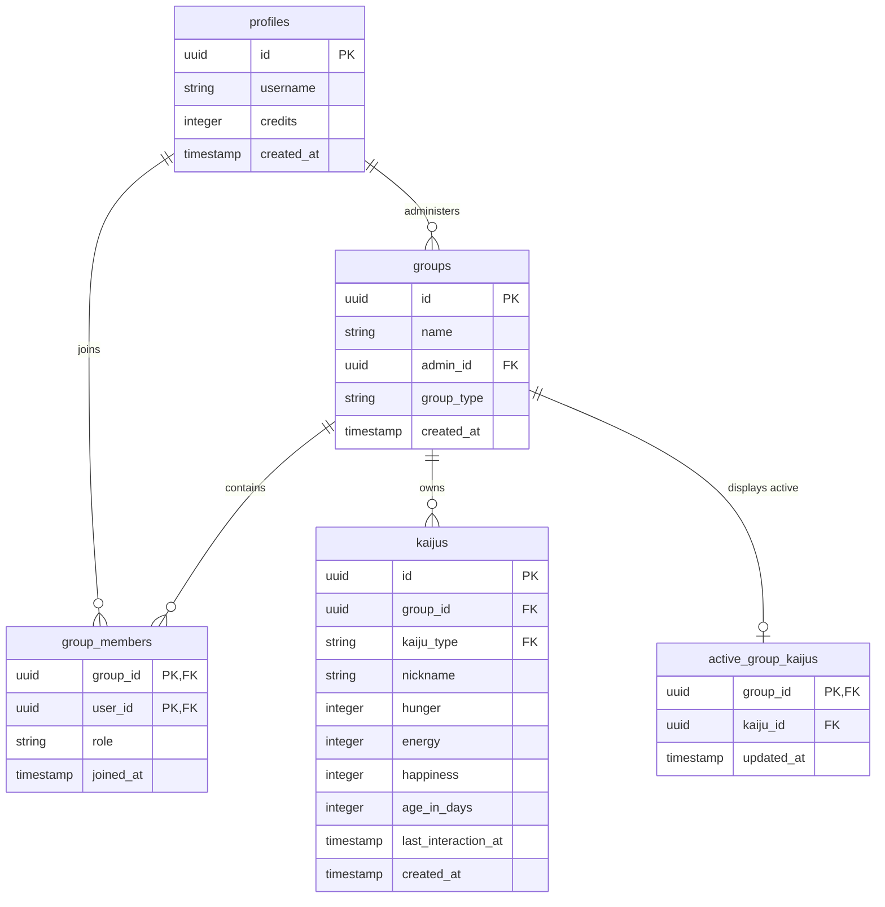
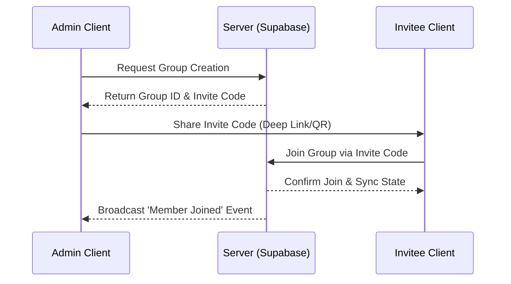
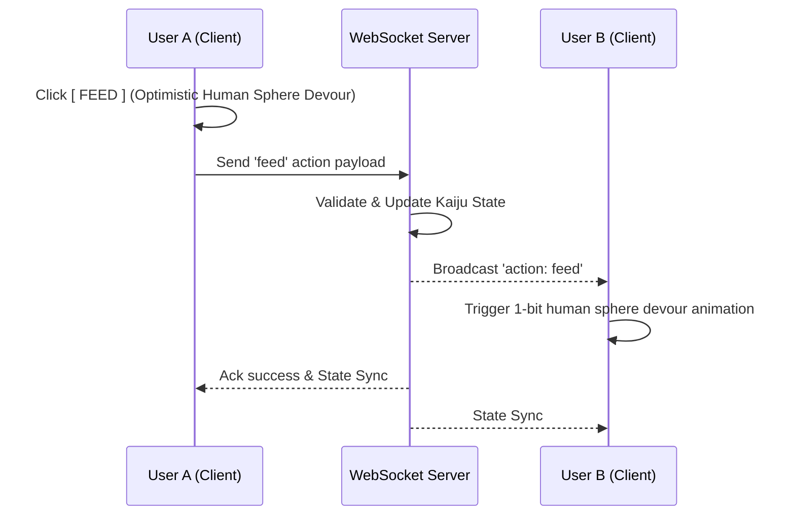

# Unix Tamagotchi: Shared Kaiju Care Architecture

## 1. Concept Overview
The core of Unix Tamagotchi's multiplayer experience is the "Care Group." Instead of individual, isolated experiences, users form a group to collaboratively manage and nurture a shared giant Kaiju (Titan). All users in a group see and interact with the **exact same active Titan instance** in the room, fostering cooperation and shared containment responsibility within an industrial terminal aesthetic.

> **Marketing Focus — Couples & Friends**: The system supports **Couples (`COUPLE`, 2 members)**, **Friend Groups (`FRIENDS`, 2 to 6 members)**, and **Solo play (`SOLO`, 1 member)**. The game is **primarily marketed as an experience for couples** co-parenting a 100-meter Titan together, while friend squads enjoy full cooperative care and group challenges.

## 2. First-Time Physical Touch Onboarding & Single-Use Code Fallback
Care Groups (`COUPLE` and `FRIENDS`) are established through an intentional **one-time physical phone-touch ritual**:

1. **First-Time Touch Handshake (NFC / BLE Proximity)**:
   - When a user wants to share their Kaiju with their partner (`COUPLE`) or invite a friend to their group (`FRIENDS`), **both phones must physically touch (or be held together) the first time**.
   - Once this initial handshake completes, the group membership is permanently recorded in the backend. **From that point onwards, all members see and care for the same Kaiju remotely from anywhere as long as they have internet connectivity** — the pairing step only applies the first time and never again.
   - To invite an additional friend into a `FRIENDS` group later, a member simply touches phones once with the new invitee.
2. **Hardware Fallback — Single-Use Invite Code**:
   - If either device does not have NFC hardware (or cannot complete the touch handshake), the inviter generates a **unique, single-use invite code** (e.g., `INV-8X2F-99A` or scannable QR).
   - Each code can only be used **once** to invite **one specific user** into the group, after which it is permanently invalidated.

## 3. Shared Kaiju Ownership & Per-Group Active Kaiju
The digital Kaiju entity is bound to the *group*, not an individual user.
- **Per-Group Active Kaiju**: The active Kaiju in the habitat room (`active_group_kaijus`) is shared across the entire group. Every member of a `COUPLE` or `FRIENDS` group sees the exact same active Kaiju in the room at all times.
- Any group member can execute care actions (e.g., `[ EAT ]`, `[ SLEEP ]`, `[ PLAY ]`).
- Kaiju care interactions, equipped Kaiju clothing, and placed habitat furniture are visible to all group members. **Credits (the in-game currency) are always per-user and are never pooled or shared.** Each member's credit balance is independent of group membership.
- The Kaiju's lifecycle, evolution, and containment status are mutually managed.

## 4. Real-Time Sync Architecture
To maintain the illusion of a living digital entity, the system relies on **Supabase Realtime WebSockets** for instant state synchronization.
- When an action is executed, it is immediately synchronized across all connected devices in the group.
- The Kaiju's 1-bit dithered pixel art animations trigger simultaneously across all viewports.

## 5. Action Broadcasting
All care actions broadcast their state to online members:
- **Action Trigger**: User A clicks `[ FEED ]`.
- **Local Response**: User A's client immediately plays the feeding animation (Optimistic UI devouring `HUMAN_SPHERE_BALL`).
- **Broadcast**: The backend broadcasts an `action_executed` payload to the group's channel.
- **Remote Response**: Users B and C see the devour animation and the subsequent stat update in real-time, along with a terminal log entry (e.g., `> SYSTEM LOG: USER_B DISPENSED HUMAN_SPHERE_BALL TO TITAN`).

## 6. Presence System
The terminal UI includes a "Secured Session" presence tracker.
- Group members currently online and viewing the kaiju are displayed in the UI (e.g., `ACTIVE_USERS: [ USER_A, USER_B ]`).
- This helps coordinate care efforts and avoids duplication of actions.

## 7. Conflict Resolution
With multiple users managing one kaiju, concurrent actions are possible.
- **Optimistic UI**: The client assumes the action will succeed and plays the local 1-bit animation.
- **Server Reconciliation**: The server acts as the source of truth. If User A and User B feed the kaiju at the exact same millisecond and the kaiju only has capacity for one food item, the server processes the first request. The second request returns a conflict state.
- **UI Correction**: The rejected client rolls back the state and displays a terminal error (e.g., `> ERR: ACTION CONFLICT. KAIJU STATUS ALREADY UPDATED.`).

## 8. Notification System
Push notifications are dispatched to alert members when the kaiju requires care, specifically targeting offline members.
- If the kaiju's hunger drops to critical levels, and *no group member is currently online*, the system sends an emergency notification.
- Example: `[ SYS_DIAG ] WARNING: VITAL SIGNS DROPPING. NUTRITION REQUIRED.`
- If one member resolves the issue, the notification is dismissed for the rest of the group.

## 9. Permission Model
- **Admin**: The group creator (or both partners in a `COUPLE` group). Can initiate physical touch pairing or generate single-use invite codes, and initiate group dissolution requests.
- **Standard Member**: Can interact with the shared kaiju, switch the group's active kaiju, spend their personal credits to buy kaijus or furniture for the group habitat, and view logs.

## 10. Data Architecture

### Entity-Relationship Diagram (ERD)

### Group Creation Flow

### Real-Time Action Sequence

