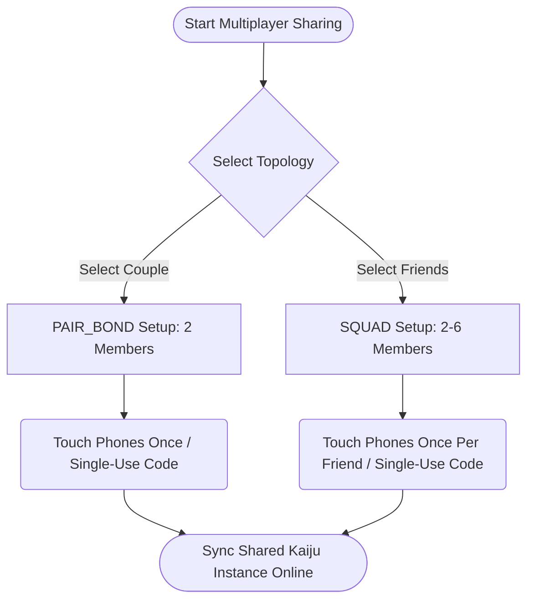
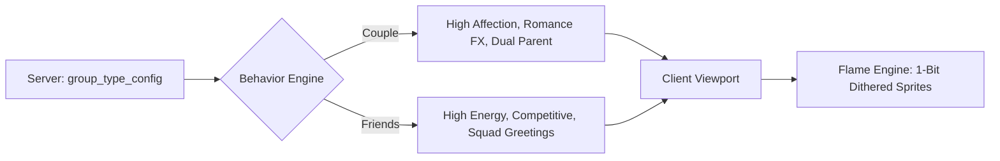

# Unix Tamagotchi: Group Types and Targeting

## 1. Group Types Overview
Care Groups in the Unix Tamagotchi ecosystem are divided into two multiplayer categories alongside solo play (`SOLO`). When an Admin initializes a shared `SECURED_SESSION`, they designate whether they are bonding with a romantic partner (`COUPLE`) or forming a friend group (`FRIENDS`). This classification dictates the Kaiju's behavioral algorithms, UI presentation, and event triggers.

> **Primary Marketing Target — `COUPLE` & `FRIENDS`**: The game is **marketed primarily as an experience for couples (`COUPLE`)**, while also fully supporting **groups of friends (`FRIENDS`)** and **solo players (`SOLO`)**. Both `COUPLE` and `FRIENDS` modes launch together in Phase 4.

### The Group Topologies
1. **Couple (`COUPLE` — 2 members)** ⭐ *Primary marketed experience*: Designed for romantic partnerships co-managing a shared Kaiju titan.
2. **Friends (`FRIENDS` — 2–6 members)**: Designed for friend squads sharing care of a Kaiju with flat, equal member permissions.
3. **Solo (`SOLO` — 1 member)**: Personal group-of-1 created automatically for every user at registration.

## 2. Kaiju Personality Differentiation
The shared digital Kaiju's 1-bit dithered animations and behavioral logic shift depending on the active group type.

### Couple Kaijus (`COUPLE`)
- **Nomenclature**: Addresses both members using parental terms (e.g., Mom/Dad, Mamá/Papá) in its dialogue and reactions. This is a **narrative/dialogue label only** — both members in a `COUPLE` group share equal `ADMIN`-level permissions.
- **Behavior**: Expresses dual affection and demonstrates romantic-themed reactions (e.g., heart particle effects rendered with stippling dispersal).
- **Events**: Acknowledges real-world couple milestones, such as relationship anniversaries.

### Friend Kaijus (`FRIENDS`)
- **Nomenclature**: Uses peer-level squad greetings. No parental titles or romantic references are used.
- **Behavior**: Highly playful, energetic, and slightly competitive. The Kaiju reacts well to rapid interactions and group milestones.
- **Events**: Focuses on shared challenges, synchronized squad rampages, and social engagement.

## 3. Group-Specific Features (Phase 4+)
- **Couple (`COUPLE`)**:
  - **Shared Milestones**: Time capsules and Kaiju/relationship anniversary dates.
  - **Couple Challenges**: Synchronized care tasks requiring both partners to participate.
- **Friends (`FRIENDS`)**:
  - **Cooperative Rampage Trials**: Squad-based "Kaiju Destruction Trials" and cooperative challenges.
  - **Squad Contribution Logs**: Tracking which friend has contributed the most care and containment actions.
  - **Kaiju Visiting (Future)**: Allowing the Kaiju to momentarily visit or raid other friend-groups' containment sectors.

## 4. UI Differentiation by Group Type
The industrial terminal interface subtly reconfigures its display based on the group type.

- **Boot Messages**: The initial system log adapts its greeting.
  - *Couple*: `> INITIALIZING PAIR_BOND PROTOCOL...`
  - *Friends*: `> INITIALIZING SQUAD PROTOCOL...`
  - *Solo*: `> INITIALIZING SOLO_CONTAINMENT PROTOCOL...`
- **Header Labels**: The active session header reflects the topology.
  - `[ PAIR_BOND: TITAN-01 ]`
  - `[ SQUAD: TITAN-01 ]`
  - `[ SOLO_SYS: TITAN-01 ]`
- **Decorative Elements**: Hazard caution stripes and camera reticles (`┌ ┐ └ ┘`) may shift in accent color distribution or pattern density depending on the group type to subconsciously orient the users.

## 5. Backend Configuration
To ensure flexibility without requiring constant client updates, personality traits are driven by backend configurations.

- **State Storage**: The active group type is stored as a string field (`group_type`) within the PostgreSQL `groups` table.
- **Behavior Rules**: Kaiju parameters (affection rate, energy decay, animation pools, dialogue labels) are loaded from the `group_type_config` table (defined in `Architecture/05`).
- **Server-Side Tuning**: Administrators can tweak personality traits per group type dynamically by adjusting the backend config, ensuring live behavioral updates without deploying new app versions.

### `group_type_config` DDL Reference
See full DDL in [Architecture/05-database-and-auth.md](../Architecture/05-database-and-auth.md). Key columns:

| Column | Type | Purpose |
|---|---|---|
| `group_type` | TEXT PK | `SOLO`, `COUPLE`, `FRIENDS` |
| `affection_rate` | NUMERIC | Multiplier for affection-based animations |
| `energy_decay_modifier` | NUMERIC | Adjusts stat decay speed per group type |
| `animation_pool` | JSONB | List of animation IDs available for this group type |
| `dialogue_labels` | JSONB | Caretaker address strings, e.g. `{"caretaker_a": "Mom", "caretaker_b": "Dad"}` |
| `special_events` | JSONB | Event definitions (anniversaries, squad milestones) |

## 6. Diagrams

### Group Type Selection Flow

### Kaiju Personality Behavior Matrix

