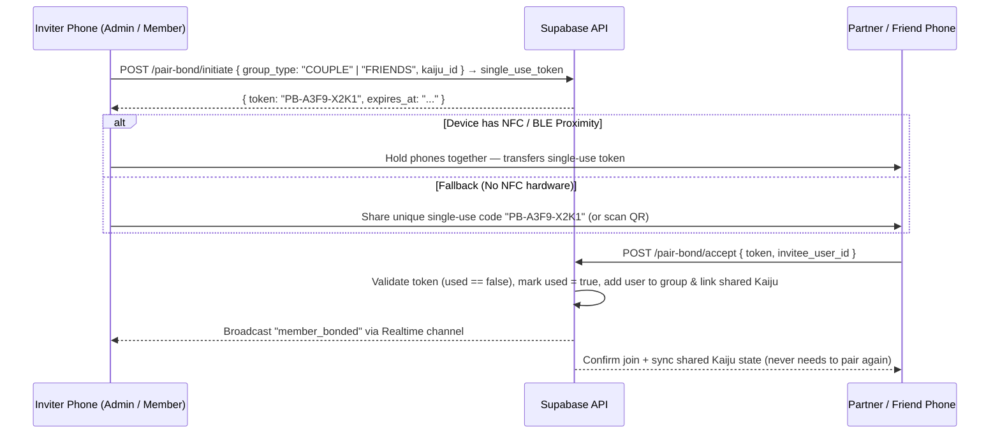

# Multiplayer: 03 One-Time Physical Touch Pairing (Couples & Friends)

## 1. Overview

The **Physical Touch Connection** is the onboarding ritual for sharing a Kaiju in both **`COUPLE`** and **`FRIENDS`** groups:

- **First-Time Physical Touch Only**: If a user wants to share their Kaiju with their partner (`COUPLE`), **both phones must physically touch the first time** (via NFC / BLE ultra-close proximity). From that point onwards, both users are permanently linked in the group and will see the **exact same Kaiju** remotely over the internet — they never need to touch phones again.
- **Adding Friends to a Group (`FRIENDS`)**: Similarly, if a user wants to share their Kaiju with a group of friends, they touch phones once with each friend they invite into the group.
- **Hardware Fallback — Single-Use Invite Code**: If a device does not have NFC hardware (or when OS-level peer-to-peer NFC is restricted, such as on iOS), the system generates a **unique, single-use invite code** (or QR code) that can be shared to invite **one specific user one time** into the group. Once redeemed by that user, the code is permanently invalidated.

---

## 2. Connection Methods (First-Time Onboarding Only)

| Method | Trigger | Range | Usage Rule | Flutter Package |
|---|---|---|---|---|
| **NFC / Proximity Touch** | Physical touch of both phones | ~4–10 cm | First-time group join only | `flutter_nfc_kit` / `flutter_blue_plus` |
| **Single-Use Invite Code / QR** | Fallback when device lacks NFC | N/A | **1 use only** — invites 1 specific user into the group | Native text input / `mobile_scanner` |

---

## 3. First-Time Touch & Single-Use Token Flow

### Sequence


### Terminal UI Copy
```text
[ INVITER SCREEN ]
> GENERATING PAIR_BOND TOKEN (COUPLE | FRIENDS)...
> SINGLE-USE FALLBACK CODE: PB-A3F9-X2K1  [ 1 USE ONLY // EXPIRES IN 60s ]
> HOLD DEVICES TOGETHER TO COMPLETE FIRST-TIME HANDSHAKE
> AWAITING PEER SIGNAL...    [■□□□□□□□]

[ INVITEE SCREEN ]
> NFC / BLE SIGNAL DETECTED (OR SINGLE-USE CODE ENTERED)
> GROUP BOND REQUEST FROM: [INVITER_NAME]
> ACCEPT PERMANENT REMOTE CONNECTION?
  [ CONFIRM ]    [ DENY ]
```

---

## 4. BLE Proximity & Single-Use Invite Code Fallbacks

1. **BLE Proximity Pairing**:
   - Inviter phone starts a BLE advertisement broadcasting a hashed pairing beacon.
   - Invitee phone scans for nearby pairing beacons and selects the inviter's device.
   - A 4-digit PIN is shown on the Inviter screen and entered on the Invitee screen to confirm physical proximity before completing the server token exchange.
2. **No-NFC / Hardware Fallback (Unique Single-Use Invite Code)**:
   - If a device lacks NFC/BLE support, the Inviter screen displays a **unique single-use invite code** (`PB-XXXX-XXXX`).
   - This code is strictly **1 use only** and can invite **only 1 specific user** into the `COUPLE` or `FRIENDS` group. As soon as that 1 user redeems it via `POST /pair-bond/accept`, the server marks `used = true` and invalidates the code permanently.
   - To invite another friend into a `FRIENDS` group (up to 6 members), a new touch handshake or a new single-use token must be generated for that individual.

---

## 5. Flutter Implementation

```dart
import 'package:flutter_nfc_kit/flutter_nfc_kit.dart';

/// Writes a single-use pairing token to an NFC tag (inviter side)
Future<void> writeNfcPairingToken(String token) async {
  final availability = await FlutterNfcKit.nfcAvailability;
  if (availability != NFCAvailability.available) {
    // Surface single-use fallback invite code UI (1 use only) instead
    return;
  }
  await FlutterNfcKit.poll(timeout: const Duration(seconds: 60));
  await FlutterNfcKit.writeNDEFRecords([NDEFRecord.plain(token)]);
  await FlutterNfcKit.finish();
}

/// Reads a pairing token from an NFC tag (invitee side)
Future<String?> readNfcPairingToken() async {
  await FlutterNfcKit.poll(timeout: const Duration(seconds: 60));
  final records = await FlutterNfcKit.readNDEFRecords();
  await FlutterNfcKit.finish();
  return records.isNotEmpty ? records.first.payload : null;
}
```

---

## 6. Security Constraints

- **Single-use token (1 user only)**: Whether transmitted via NFC/BLE touch or typed as a no-NFC fallback code, a pairing token is consumed on first acceptance (`used = true`) and adds **at most 1 user** to the group. Any subsequent attempt to use the same token returns `409 CONFLICT`.
- **First-time pairing only**: Once two users have bonded into a `COUPLE` or `FRIENDS` group, their membership is persisted in `group_members`. They never need to touch phones again and can care for the group's active Kaiju remotely over the internet.
- **60-second TTL**: Expired tokens return `410 GONE`. The server enforces expiry — never the client.
- **Server-side group creation & capacity check**: The `COUPLE` (max 2 members) or `FRIENDS` (max 6 members) group membership is written exclusively by the server after both user IDs and capacity constraints are validated. The client never writes to `groups` or `group_members` directly.
- **One active COUPLE group per user**: The server rejects a `COUPLE` pairing request if either user is already a member of an active `COUPLE` group.
- **No token in logs**: Pairing tokens must be excluded from all analytics, crash reporting, and FCM pipelines.

See [Security/01-security-overview.md](../Security/01-security-overview.md) for the `pair_bond_tokens` DDL.

---

## 7. Required Permissions

| Platform | Permission | Reason |
|---|---|---|
| Android | `NEAR_FIELD_COMMUNICATION` | NFC read/write |
| Android | `BLUETOOTH_SCAN`, `BLUETOOTH_CONNECT` | BLE pairing |
| iOS | `NFCReaderUsageDescription` (Info.plist) | NFC read |
| iOS | `NSBluetoothAlwaysUsageDescription` | BLE pairing |
