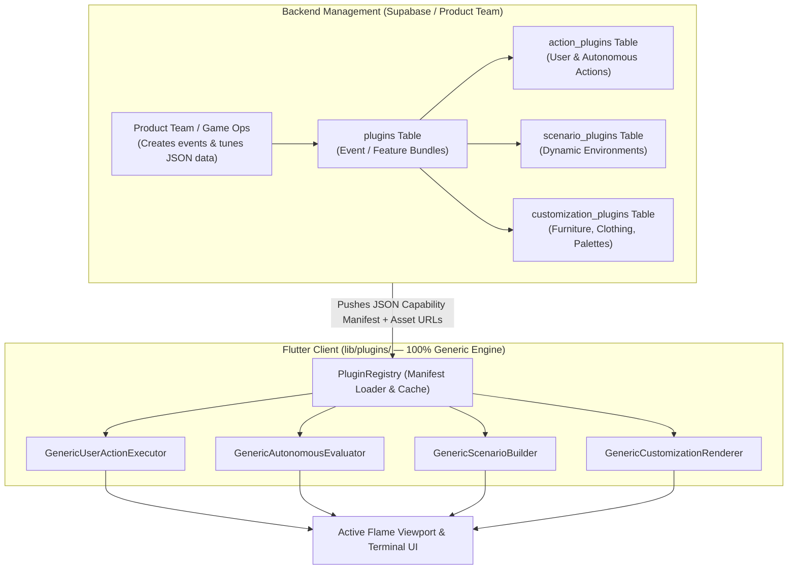

# Plugins: 01 Plugin Architecture Overview

This document specifies the core architecture for the **100% Data-Driven Plugin System** in the **Unix Tamagotchi**, explaining how plugins (which bundle scenarios, user-triggered actions, autonomous actions, and customizations like furniture and clothing) are defined in the backend and interpreted generically by the Flutter frontend without requiring codebase modifications.

---

## 1. Architectural Philosophy: Data-Driven Plugin Bundles

In traditional mobile apps, adding a new event, seasonal action, room environment, furniture piece, or Kaiju clothing item requires writing new client classes, compiling a new binary, passing app store review, and forcing users to update.

In **Unix Tamagotchi**, the Flutter frontend is **100% generic and data-driven**:
- A **Plugin** is a logical package/bundle (`plugins` table) managed by the product team that can contain any combination of:
  1. **Scenarios** (`scenario_plugins`): Visual room environments, background/foreground sprite layers, z-index priorities, and anchor points.
  2. **User-Triggered Actions** (`action_plugins` where `action_type = 'USER_TRIGGERED'`): Interactive terminal buttons, prerequisites (energy, age phase, required furniture), stat deltas, credit rewards, animation triggers, and target scenarios.
  3. **Autonomous Actions** (`action_plugins` where `action_type = 'AUTONOMOUS'`): Time- or condition-triggered routines (e.g., City Rampage work shifts, Demolition Academy study, Clinic recovery) with hourly stat/credit formulas, furniture prerequisites (e.g., desk & chair required to study), and priority rules.
  4. **Customizations** (`customization_plugins`): Habitat **Furniture**, Kaiju **Clothing/Accessories**, **Skins**, **Room Palette Themes**, and **Boot Messages**, including prices, required stats, passive stat modifiers, and sprite/shader rendering metadata.

The backend controls:
1. **Activation State**: Whether the plugin bundle or individual item is enabled (`is_enabled: true`).
2. **Availability Window**: Specific dates and times when the plugin is active (`valid_from`, `valid_until`).
3. **Execution & Rendering Parameters**: Dynamic JSON payloads (payout rates, stat deltas, required furniture, remote sprite sheet URLs, coordinates) interpreted directly by the frontend's generic executors.
4. **Target Scenario Binding**: Which environment scenario the Kaiju transitions to when an action is executed.



---

## 2. Codebase Directory Organization

Inside the Flutter application (`lib/plugins/`), no specific event or action is hardcoded as a standalone class (except parameterized interactive minigame templates in Phase 5+). Instead, the directory houses data models and generic interpreters:

```
lib/plugins/
├── plugin_registry.dart                        # Centralized manifest loader, cache & query API
├── models/                                     # Immutable JSON-serializable data configs
│   ├── plugin_bundle_config.dart               # Parent plugin package metadata & schedule
│   ├── action_plugin_config.dart               # User-triggered & autonomous action rules/deltas
│   ├── scenario_plugin_config.dart             # Layer definitions, sprite URLs & anchor points
│   └── customization_plugin_config.dart        # Furniture, clothing, skin & palette definitions
│
├── executors/                                  # Generic data-driven runtime interpreters
│   ├── generic_user_action_executor.dart       # Evaluates prerequisites & computes ActionResult
│   ├── generic_autonomous_evaluator.dart       # Evaluates time-elapsed work, study & recovery
│   ├── generic_scenario_builder.dart           # Builds Flame Component tree from JSON layers
│   └── generic_customization_renderer.dart     # Renders room furniture, Kaiju clothing & palettes
│
└── minigames/                                  # Parameterized Flame minigame engines (Phase 5+)
```

> **Phase 1 (Offline PoC) Note**: During the offline PoC, `PluginRegistry` loads a bundled local JSON file (`assets/manifests/poc_default_manifest.json`) containing the initial 3 actions (`eat`, `sleep`, `play`), `default_room` scenario, and palette presets. In Phase 2+, the exact same generic engine loads the manifest from Supabase!

---

## 3. Core Dart Data Contracts

### A. Age Phase Enum (`lib/models/age_phase.dart`)

All age-gate logic references this enum. During the PoC, every Kaiju starts at `AgePhase.child` as a static value; real aging computation is introduced in Phase 3 via `Features/05-kaiju-lifecycle-and-aging.md`. Starting at `child` ensures the three core PoC actions (Eat, Sleep, Play) are all unlocked from day one.

```dart
/// Ordered by lifecycle progression — ordinal comparisons are intentional.
enum AgePhase { baby, child, young, adult, elder }

extension AgePhaseName on AgePhase {
  String get label => name.toUpperCase(); // e.g. 'ADULT'
}
```

---

### B. Data-Driven Action Config & Generic Executor (`lib/plugins/models/action_plugin_config.dart`)

```dart
import 'package:flutter/foundation.dart';
import '../../models/age_phase.dart';
import '../../models/kaiju_state.dart';

enum ActionType { userTriggered, autonomous, minigame }

@immutable
class ActionPluginConfig {
  final String id;                // e.g. 'eat', 'crush_tank', 'city_destruction', 'destruction_study'
  final String? pluginId;         // Parent plugin bundle ID
  final String displayName;       // User-facing terminal button label
  final ActionType actionType;    // userTriggered | autonomous | minigame
  final bool isEnabled;
  final DateTime? validFrom;
  final DateTime? validUntil;
  final String targetScenarioId;  // e.g. 'default_room', 'metropolis_ruins'
  final AgePhase? minAgePhase;
  final AgePhase? maxAgePhase;
  final List<String> requiredFurniture; // e.g. ['itm_desk', 'itm_chair'] for study
  final int priority;             // Lower value = higher precedence (0 overrides all)
  final List<String> blockingConditions; // e.g. ['is_sick', 'is_exhausted']
  final Map<String, dynamic> parameters; // Stat deltas, hourly rates, messages, animation key, duration

  const ActionPluginConfig({
    required this.id,
    this.pluginId,
    required this.displayName,
    required this.actionType,
    this.isEnabled = true,
    this.validFrom,
    this.validUntil,
    required this.targetScenarioId,
    this.minAgePhase,
    this.maxAgePhase,
    this.requiredFurniture = const [],
    this.priority = 50,
    this.blockingConditions = const [],
    this.parameters = const {},
  });

  bool isAgeEligible(AgePhase kaijuPhase) {
    final min = minAgePhase;
    final max = maxAgePhase;
    if (min != null && kaijuPhase.index < min.index) return false;
    if (max != null && kaijuPhase.index > max.index) return false;
    return true;
  }

  bool hasRequiredFurniture(List<String> placedFurnitureIds) {
    return requiredFurniture.every((reqId) => placedFurnitureIds.contains(reqId));
  }
}

class ActionResult {
  final bool success;
  final String message;
  final int hungerDelta;
  final int energyDelta;
  final int happinessDelta;
  final Map<String, int> extendedStatDeltas; // e.g. {'intel': 10} in Phase 3+
  final int creditsEarned;
  final String animationSequence;
  final String targetScenarioId;
  final Duration duration;

  const ActionResult({
    required this.success,
    required this.message,
    this.hungerDelta = 0,
    this.energyDelta = 0,
    this.happinessDelta = 0,
    this.extendedStatDeltas = const {},
    this.creditsEarned = 0,
    required this.animationSequence,
    required this.targetScenarioId,
    required this.duration,
  });
}
```

---

### C. Data-Driven Scenario Config (`lib/plugins/models/scenario_plugin_config.dart`)

```dart
import 'package:flame/components.dart';

class ScenarioLayerConfig {
  final String spriteAssetOrUrl;
  final Vector2 position;
  final Vector2 size;
  final int priority; // Z-index (0-20 bg, 21-49 props/furniture behind Kaiju, 50 Kaiju, 51+ foreground)

  const ScenarioLayerConfig({
    required this.spriteAssetOrUrl,
    required this.position,
    required this.size,
    required this.priority,
  });
}

class ScenarioPluginConfig {
  final String id; // e.g. 'default_room', 'hospital_bed', 'metropolis_ruins'
  final String? pluginId;
  final String displayName;
  final bool isEnabled;
  final Vector2 kaijuAnchorPoint;
  final List<ScenarioLayerConfig> layers;
  final Map<String, dynamic> parameters;

  const ScenarioPluginConfig({
    required this.id,
    this.pluginId,
    required this.displayName,
    this.isEnabled = true,
    required this.kaijuAnchorPoint,
    this.layers = const [],
    this.parameters = const {},
  });
}
```

---

### D. Data-Driven Customization Config (`lib/plugins/models/customization_plugin_config.dart`)

```dart
enum CustomizationCategory { furniture, clothing, skin, palette, bootMessage }

class CustomizationPluginConfig {
  final String id; // e.g. 'itm_desk', 'clothing_mech_visor', 'palette_amber'
  final String? pluginId;
  final CustomizationCategory category;
  final String displayName;
  final int priceCredits;
  final bool isEnabled;
  final String? requiredStat; // Item is only active if this stat is enabled in current game phase
  final Map<String, num> statModifiers; // e.g. {'intel': 25, 'happiness': -10}
  final Map<String, dynamic> renderData; // Sprite URL, slot position, z-priority, or shader hex colors

  const CustomizationPluginConfig({
    required this.id,
    this.pluginId,
    required this.category,
    required this.displayName,
    this.priceCredits = 0,
    this.isEnabled = true,
    this.requiredStat,
    this.statModifiers = const {},
    this.renderData = const {},
  });
}
```

---

## 4. Central Data-Driven Plugin Registry (`lib/plugins/plugin_registry.dart`)

The `PluginRegistry` stores the active data configurations loaded from the local PoC JSON manifest (Phase 1) or the Supabase backend (Phase 2+):

```dart
class PluginRegistry {
  static final PluginRegistry _instance = PluginRegistry._internal();
  factory PluginRegistry() => _instance;
  PluginRegistry._internal();

  final Map<String, ActionPluginConfig> _actions = {};
  final Map<String, ScenarioPluginConfig> _scenarios = {};
  final Map<String, CustomizationPluginConfig> _customizations = {};

  /// Syncs active configurations from local PoC JSON or backend capability manifest
  void applyBackendManifest({
    required List<ActionPluginConfig> activeActions,
    required List<ScenarioPluginConfig> activeScenarios,
    required List<CustomizationPluginConfig> activeCustomizations,
  }) {
    _actions
      ..clear()
      ..addEntries(activeActions.where((a) => a.isEnabled).map((a) => MapEntry(a.id, a)));

    _scenarios
      ..clear()
      ..addEntries(activeScenarios.where((s) => s.isEnabled).map((s) => MapEntry(s.id, s)));

    _customizations
      ..clear()
      ..addEntries(activeCustomizations.where((c) => c.isEnabled).map((c) => MapEntry(c.id, c)));
  }

  /// Returns user-triggered actions eligible for the Kaiju's current age and room furniture
  List<ActionPluginConfig> getEnabledUserActions({
    required AgePhase kaijuPhase,
    List<String> placedFurnitureIds = const [],
  }) {
    return _actions.values.where((action) {
      return action.actionType == ActionType.userTriggered &&
          action.isAgeEligible(kaijuPhase) &&
          action.hasRequiredFurniture(placedFurnitureIds);
    }).toList();
  }

  ScenarioPluginConfig getScenario(String id) {
    return _scenarios[id] ?? _scenarios['default_room']!;
  }

  List<CustomizationPluginConfig> getCustomizationsByCategory(CustomizationCategory category) {
    return _customizations.values.where((c) => c.category == category).toList();
  }
}
```
