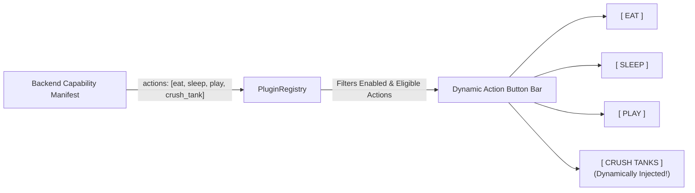

# Plugins: 02 User-Triggered Actions

This document specifies the data-driven architecture and generic execution of **User-Triggered Action Plugins** in the **Unix Tamagotchi**.

---

## 1. Architectural Concept

User-triggered actions represent interactions initiated directly by the player tapping a terminal button in the UI.

Everything is **data-driven**:
- In the initial PoC (Milestone 1.1), **Eat**, **Sleep**, and **Play** are defined in the bundled JSON manifest (`poc_default_manifest.json`) and executed by `GenericUserActionExecutor`.
- In Phase 2+, seasonal events or special abilities (such as **Crush Tanks** or **Search for Relic**) are created and enabled in the backend `action_plugins` table by the product team. They automatically appear as interactive buttons in the UI without any client code changes.



---

## 2. Dynamic UI Action Injection

Instead of hardcoding static buttons in the containment room, the screen dynamically queries the `PluginRegistry` through a Riverpod provider to generate monospace bracket buttons:

```dart
// lib/features/room/widgets/action_button_bar.dart
import 'package:flutter/material.dart';
import 'package:flutter_riverpod/flutter_riverpod.dart';
import '../../../plugins/plugin_registry.dart';
import '../../../models/age_phase.dart';
import '../../../core/widgets/retro_button.dart';
import '../../../state/kaiju_state_notifier.dart';

class DynamicActionButtonBar extends ConsumerWidget {
  const DynamicActionButtonBar({super.key});

  @override
  Widget build(BuildContext context, WidgetRef ref) {
    final enabledActions = PluginRegistry().getEnabledUserActions(
      kaijuPhase: AgePhase.child, // Resolved dynamically in Phase 3+
    );

    return SingleChildScrollView(
      scrollDirection: Axis.horizontal,
      child: Row(
        mainAxisAlignment: MainAxisAlignment.center,
        children: enabledActions.map((actionConfig) {
          return Padding(
            padding: const EdgeInsets.symmetric(horizontal: 4.0),
            child: RetroButton(
              label: actionConfig.displayName.toUpperCase(),
              onPressed: () {
                ref.read(gameStateProvider.notifier).executePluginAction(actionConfig);
              },
            ),
          );
        }).toList(),
      ),
    );
  }
}
```

---

## 3. Generic User Action Executor (`lib/plugins/executors/generic_user_action_executor.dart`)

Rather than writing a separate Dart class for every action (`EatActionPlugin`, `CrushTankActionPlugin`), a single generic interpreter evaluates the JSON parameters of any `ActionPluginConfig`:

```dart
import '../models/action_plugin_config.dart';
import '../../models/kaiju_state.dart';

class GenericUserActionExecutor {
  static ActionResult execute({
    required KaijuInstance currentKaiju,
    required ActionPluginConfig config,
    required DateTime triggeredAt,
  }) {
    final params = config.parameters;

    // 1. Check blocking status flags (e.g. 'is_exhausted' in Milestone 1.2+, 'is_sick' in Phase 3+)
    for (final condition in config.blockingConditions) {
      if (currentKaiju.statusFlags[condition] == true) {
        return ActionResult(
          success: false,
          message: '> [ALERT] ${currentKaiju.nickname} cannot perform ${config.displayName} ($condition).',
          animationSequence: 'idle',
          targetScenarioId: currentKaiju.activeScenarioId,
          duration: Duration.zero,
        );
      }
    }

    // 2. Check minimum energy prerequisite if configured
    final minEnergy = (params['min_energy'] as num?)?.toInt() ?? 0;
    if (currentKaiju.energy < minEnergy) {
      final alertMsg = (params['low_energy_message'] as String?) ??
          '> [ALERT] ${currentKaiju.nickname} is too exhausted for ${config.displayName}! (Needs $minEnergy% energy)';
      return ActionResult(
        success: false,
        message: alertMsg.replaceAll('{nickname}', currentKaiju.nickname),
        animationSequence: 'idle',
        targetScenarioId: currentKaiju.activeScenarioId,
        duration: Duration.zero,
      );
    }

    // 3. Read stat & credit deltas from JSON parameters
    final hungerDelta = (params['hunger_delta'] as num?)?.toInt() ?? 0;
    final energyDelta = (params['energy_delta'] as num?)?.toInt() ?? 0;
    final happinessDelta = (params['happiness_delta'] as num?)?.toInt() ?? 0;
    final creditReward = (params['credit_reward'] as num?)?.toInt() ?? 0;
    final animationSeq = (params['animation_sequence'] as String?) ?? 'idle';
    final durationMs = (params['duration_ms'] as num?)?.toInt() ?? 3000;
    final targetScenario = (params['scenario_id'] as String?) ?? config.targetScenarioId;

    final rawMessage = (params['success_message'] as String?) ??
        'Executed ${config.displayName} on ${currentKaiju.nickname}.';

    return ActionResult(
      success: true,
      message: rawMessage.replaceAll('{nickname}', currentKaiju.nickname),
      hungerDelta: hungerDelta,
      energyDelta: energyDelta,
      happinessDelta: happinessDelta,
      creditsEarned: creditReward,
      animationSequence: animationSeq,
      targetScenarioId: targetScenario,
      duration: Duration(milliseconds: durationMs),
    );
  }
}
```

### Example Data Configurations (PoC & Event Actions)

```json
[
  {
    "id": "eat",
    "plugin_id": "core_base",
    "display_name": "Eat",
    "action_type": "USER_TRIGGERED",
    "target_scenario_id": "default_room",
    "parameters": {
      "hunger_delta": 25,
      "energy_delta": -5,
      "happiness_delta": 5,
      "animation_sequence": "eating",
      "duration_ms": 3500,
      "success_message": "Fed {nickname} a ball of human people. Hunger +25%"
    }
  },
  {
    "id": "crush_tank",
    "plugin_id": "military_defense_event",
    "display_name": "Crush Tanks",
    "action_type": "USER_TRIGGERED",
    "target_scenario_id": "metropolis_ruins",
    "min_age_phase": "young",
    "max_age_phase": "adult",
    "blocking_conditions": ["is_sick", "is_exhausted"],
    "parameters": {
      "min_energy": 25,
      "hunger_delta": -20,
      "energy_delta": -25,
      "happiness_delta": 40,
      "credit_reward": 25,
      "animation_sequence": "tank_crush_stomp",
      "duration_ms": 4000,
      "success_message": "{nickname} pulverized incoming military tanks! Joy +40%, Salvaged 25 credits!"
    }
  }
]
```
