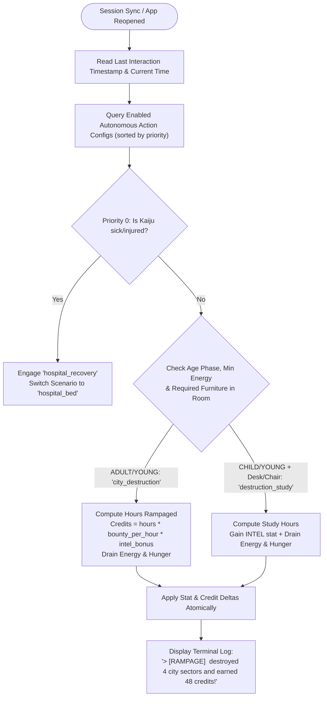

# Plugins: 03 Non-User-Triggered Actions (Autonomous Plugins)

This document specifies the data-driven architecture, furniture-gated triggers, scheduling, and deterministic execution of **Non-User-Triggered Actions** (Autonomous Actions) in the **Unix Tamagotchi**.

---

## 1. Architectural Concept

Unlike user actions triggered by button taps, **Non-User-Triggered Actions** trigger autonomously based on backend-configured data rules:
1. **Circumstantial & Lifecycle Conditions**: Kaiju reaching a target age phase (e.g., `child`/`young` for study, `young`/`adult` for work), Kaiju exhaustion/sickness, or stat thresholds.
2. **Furniture Prerequisites**: Certain autonomous actions require specific furniture customization plugins to be placed in the group's habitat room! For example, **Demolition Study (`destruction_study`)** requires a desktop workstation and chair (`required_furniture: ["itm_desk", "itm_chair"]`) in the room so the Kaiju can study.
3. **Scheduled / Elapsed Time Windows**: Autonomous routines evaluate elapsed hours (up to `max_shift_hours`) to award credits or extended stats (`intel`) and apply stat decay.



---

## 2. Generic Autonomous Evaluator (`lib/plugins/executors/generic_autonomous_evaluator.dart`)

Instead of hardcoding classes like `CityDestructionActionPlugin` or `DestructionStudyActionPlugin`, the frontend uses a single data-driven evaluator that interprets the JSON parameters of any `ActionPluginConfig` where `actionType == ActionType.autonomous`:

```dart
import '../models/action_plugin_config.dart';
import '../../models/age_phase.dart';
import '../../models/kaiju_state.dart';

class AutonomousExecutionResult {
  final int creditsEarned;
  final int hungerDelta;
  final int energyDelta;
  final int happinessDelta;
  final Map<String, int> extendedStatDeltas; // e.g. {'intel': 15}
  final String statusSummary;
  final String? overrideScenarioId;

  const AutonomousExecutionResult({
    this.creditsEarned = 0,
    this.hungerDelta = 0,
    this.energyDelta = 0,
    this.happinessDelta = 0,
    this.extendedStatDeltas = const {},
    required this.statusSummary,
    this.overrideScenarioId,
  });
}

class GenericAutonomousEvaluator {
  /// Checks if all data-driven conditions are met for this autonomous action to engage
  static bool shouldTrigger({
    required KaijuInstance kaiju,
    required AgePhase currentPhase,
    required List<String> placedFurnitureIds,
    required ActionPluginConfig config,
  }) {
    if (!config.isEnabled) return false;
    if (!config.isAgeEligible(currentPhase)) return false;
    if (!config.hasRequiredFurniture(placedFurnitureIds)) return false;

    for (final condition in config.blockingConditions) {
      if (kaiju.statusFlags[condition] == true) return false;
    }

    final minEnergy = (config.parameters['min_energy'] as num?)?.toInt() ?? 0;
    if (kaiju.energy < minEnergy) return false;

    final requiredFlag = config.parameters['required_status_flag'] as String?;
    if (requiredFlag != null && kaiju.statusFlags[requiredFlag] != true) {
      return false;
    }

    return true;
  }

  /// Computes deterministic state changes over elapsed time from JSON rates
  static AutonomousExecutionResult computeElapsedProgress({
    required KaijuInstance kaiju,
    required DateTime startTime,
    required DateTime endTime,
    required ActionPluginConfig config,
  }) {
    final params = config.parameters;
    final maxShiftHrs = (params['max_shift_hours'] as num?)?.toDouble() ?? 8.0;
    final elapsedHours = endTime.difference(startTime).inMinutes / 60.0;
    final actualHours = elapsedHours.clamp(0.0, maxShiftHrs);

    final bountyPerHr = (params['bounty_per_hour'] as num?)?.toDouble() ?? 0.0;
    final hungerRatePerHr = (params['hunger_per_hour'] as num?)?.toDouble() ?? 0.0;
    final energyRatePerHr = (params['energy_per_hour'] as num?)?.toDouble() ?? 0.0;
    final happinessRatePerHr = (params['happiness_per_hour'] as num?)?.toDouble() ?? 0.0;

    // Optional INTEL bonus multiplier on work payouts (Phase 3+)
    final intel = kaiju.extendedStats['intel'] ?? 0;
    final intelScale = (params['intel_bounty_scale'] as num?)?.toDouble() ?? 0.0;
    final effectiveBounty = bountyPerHr * (1.0 + (intel * intelScale));

    final credits = (actualHours * effectiveBounty).round();
    final hungerDelta = (actualHours * hungerRatePerHr).round();
    final energyDelta = (actualHours * energyRatePerHr).round();
    final happinessDelta = (actualHours * happinessRatePerHr).round();

    // Progressive extended stat deltas (e.g. 'intel_per_hour' for study)
    final Map<String, int> extDeltas = {};
    final rawExtRates = params['extended_stat_rates_per_hour'] as Map<String, dynamic>?;
    if (rawExtRates != null) {
      rawExtRates.forEach((statKey, rateVal) {
        extDeltas[statKey] = (actualHours * (rateVal as num).toDouble()).round();
      });
    }

    final template = (params['summary_template'] as String?) ??
        '> [AUTO] {nickname} completed ${config.displayName} (${actualHours.toStringAsFixed(1)}h).';

    return AutonomousExecutionResult(
      creditsEarned: credits,
      hungerDelta: hungerDelta,
      energyDelta: energyDelta,
      happinessDelta: happinessDelta,
      extendedStatDeltas: extDeltas,
      statusSummary: template
          .replaceAll('{nickname}', kaiju.nickname)
          .replaceAll('{hours}', actualHours.toStringAsFixed(1))
          .replaceAll('{credits}', credits.toString()),
      overrideScenarioId: config.targetScenarioId,
    );
  }
}
```

---

## 3. Data-Driven Examples: Study (Furniture-Gated) & City Destruction Work

When **Demolition Study (`destruction_study`)** is introduced in Phase 3 alongside the `intel` stat, its plugin bundle also enables the **Desktop Workstation & Chair (`itm_desk`)** furniture item. The action configuration declares `"required_furniture": ["itm_desk"]`:

```json
[
  {
    "id": "destruction_study",
    "plugin_id": "study_academy_pack",
    "display_name": "Demolition Academy",
    "action_type": "AUTONOMOUS",
    "target_scenario_id": "default_room",
    "min_age_phase": "child",
    "max_age_phase": "young",
    "required_furniture": ["itm_desk"],
    "priority": 40,
    "blocking_conditions": ["is_sick", "is_exhausted"],
    "parameters": {
      "min_energy": 15,
      "max_shift_hours": 6.0,
      "hunger_per_hour": -3.0,
      "energy_per_hour": -4.0,
      "happiness_per_hour": 2.0,
      "extended_stat_rates_per_hour": {
        "intel": 5.0
      },
      "summary_template": "> [ACADEMY] {nickname} studied {hours}h of urban demolition tactics at WORK_STN."
    }
  },
  {
    "id": "city_destruction",
    "plugin_id": "city_rampage_pack",
    "display_name": "City Rampage",
    "action_type": "AUTONOMOUS",
    "target_scenario_id": "metropolis_ruins",
    "min_age_phase": "young",
    "max_age_phase": "adult",
    "required_furniture": [],
    "priority": 50,
    "blocking_conditions": ["is_sick", "is_exhausted"],
    "parameters": {
      "min_energy": 20,
      "max_shift_hours": 8.0,
      "bounty_per_hour": 12.0,
      "intel_bounty_scale": 0.01,
      "hunger_per_hour": -4.0,
      "energy_per_hour": -6.0,
      "summary_template": "> [RAMPAGE] {nickname} leveled urban sectors over {hours}h and earned {credits} credits!"
    }
  }
]
```

---

## 4. Deterministic Execution in Solo vs. Multiplayer Groups

1. **Offline PoC (Milestone 1.1)**: Autonomous plugins are disabled (`is_enabled: false`).
2. **Connected Solo & Multiplayer Groups (Phase 3 & Phase 4)**:
   - Because a Kaiju in a `COUPLE` or `FRIENDS` group is shared by multiple players, autonomous progress is evaluated **atomically on the server** (via Supabase Edge Function / PostgreSQL function triggered on group state sync or `pg_cron`) using `kaijus.last_interaction_at`.
   - Stat deltas (`hunger`, `energy`, `happiness`, `extended_stats`) are applied **once** to the shared Kaiju row.
   - Any `creditsEarned` from an autonomous work shift (`city_destruction`) are credited via `add_credits()` to each member of the group (since credits are per-user and never pooled).

