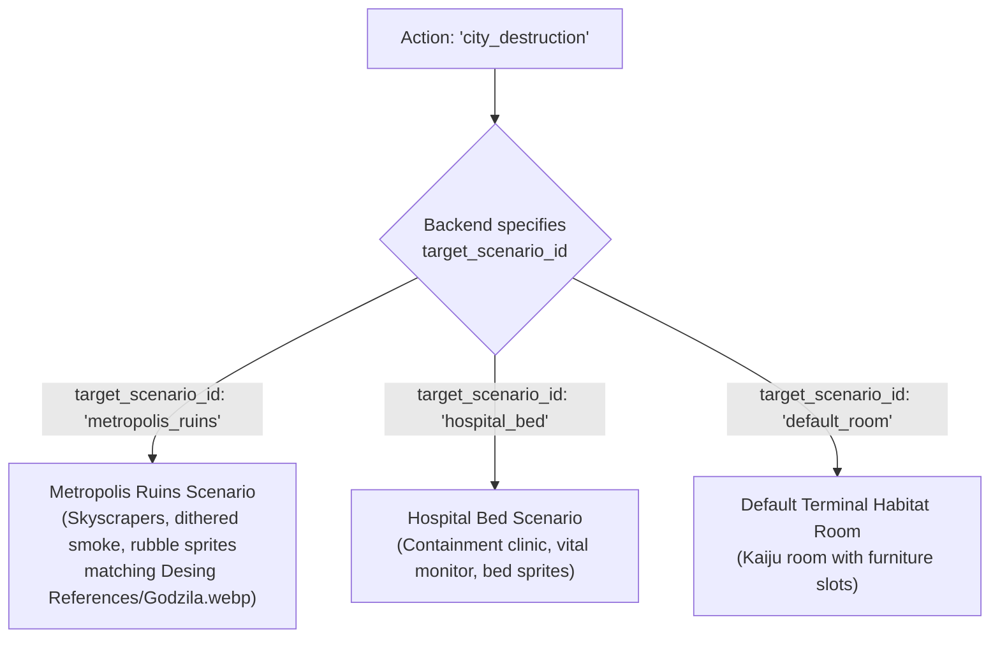

# Plugins: 04 Scenarios and Environments

This document specifies the data-driven architecture, generic Flame scene builder, and composability rules for **Scenario Plugins** in the **Unix Tamagotchi**.

---

## 1. Architectural Concept: Data-Driven Decoupled Scenarios

In traditional kaiju games, rooms are static hardcoded scenes. In **Unix Tamagotchi**, scenarios are data-driven configurations (`ScenarioPluginConfig`) interpreted by `GenericScenarioBuilder`.

Scenarios are **completely decoupled from actions**:
- An action (e.g., "City Rampage" or "Crush Tanks") specifies which `target_scenario_id` to load (e.g., `"metropolis_ruins"` or `"hospital_bed"`).
- Crucially, the product team can **create brand-new scenarios or rebind actions to different scenarios dynamically** via backend JSON parameters. For example, if a seasonal event features city destruction in a futuristic skyline or containment inside an arctic silo, the backend defines the new scenario's sprite layers and overrides the action's `target_scenario_id` without modifying a single line of Flutter code.



---

## 2. Unified 1-Bit Dithered Scene Rendering

Every scenario configuration generates a scene for the Flame engine viewport via `GenericScenarioBuilder`. The rendering pipeline operates in two stages:
1. **Low-Resolution Compositing**: `GenericScenarioBuilder` constructs a scene graph of `SpriteComponent` and `PositionComponent` objects from the scenario's JSON `layers` array (background, environment props, placed group furniture, the Kaiju + any equipped clothing layers, and foreground effects) at a low virtual resolution (e.g., 256×256).
2. **Post-Processing Pipeline**: A global Fragment Shader is applied to the viewport, processing the scene using an ordered Bayer matrix to achieve the signature 1-bit dithered shading. The final output is upscaled using nearest-neighbor filtering to provide crisp, chunky pixels underneath the Flutter native-resolution UI layer.

---

## 3. Generic Scenario Builder (`lib/plugins/executors/generic_scenario_builder.dart`)

Instead of writing separate Dart classes for `HospitalBedScenarioPlugin` or `MetropolisRuinsScenarioPlugin`, `GenericScenarioBuilder` reads any `ScenarioPluginConfig` JSON payload and assembles the Flame component tree dynamically:

```dart
import 'package:flame/components.dart';
import '../models/scenario_plugin_config.dart';
import '../models/customization_plugin_config.dart';

class GenericScenarioBuilder {
  /// Builds a complete 1-bit dithered Flame scene graph from data configuration
  static Component buildScene({
    required ScenarioPluginConfig scenarioConfig,
    required Component kaijuComponent,
    required List<CustomizationPluginConfig> placedFurniture,
    required Sprite Function(String assetOrUrl) spriteLoader,
  }) {
    final sceneRoot = PositionComponent(position: Vector2.zero());

    // 1. Add all scenario layers (backgrounds at priority 0-20, props at 21-49, foreground at 51-100)
    for (final layer in scenarioConfig.layers) {
      sceneRoot.add(SpriteComponent(
        sprite: spriteLoader(layer.spriteAssetOrUrl),
        position: layer.position,
        size: layer.size,
        priority: layer.priority,
      ));
    }

    // 2. If this scenario supports room furniture (e.g. 'default_room'), render placed furniture (priority 21-49)
    if (scenarioConfig.parameters['supports_furniture'] == true) {
      for (final item in placedFurniture) {
        final spriteUrl = item.renderData['sprite_url'] as String?;
        if (spriteUrl == null) continue;
        final x = (item.renderData['x'] as num?)?.toDouble() ?? 0.0;
        final y = (item.renderData['y'] as num?)?.toDouble() ?? 0.0;
        final w = (item.renderData['width'] as num?)?.toDouble() ?? 32.0;
        final h = (item.renderData['height'] as num?)?.toDouble() ?? 32.0;
        final z = (item.renderData['priority'] as num?)?.toInt() ?? 30;

        sceneRoot.add(SpriteComponent(
          sprite: spriteLoader(spriteUrl),
          position: Vector2(x, y),
          size: Vector2(w, h),
          priority: z.clamp(21, 49),
        ));
      }
    }

    // 3. Anchor the Kaiju sprite at the scenario's configured kaijuAnchorPoint (priority 50)
    kaijuComponent.position = scenarioConfig.kaijuAnchorPoint;
    kaijuComponent.priority = 50;
    sceneRoot.add(kaijuComponent);

    return sceneRoot;
  }
}
```

---

## 4. Example Data Configurations: `hospital_bed` & `metropolis_ruins`

```json
[
  {
    "id": "hospital_bed",
    "plugin_id": "clinic_recovery_pack",
    "display_name": "Clinic Recovery Ward",
    "is_enabled": true,
    "kaiju_anchor_point": { "x": 128, "y": 160 },
    "parameters": {
      "supports_furniture": false,
      "vital_monitor": true,
      "iv_drip_level": "FULL"
    },
    "layers": [
      { "sprite": "scenarios/clinic_wall.png", "x": 0, "y": 0, "w": 256, "h": 256, "priority": 0 },
      { "sprite": "scenarios/vital_monitor.png", "x": 20, "y": 100, "w": 32, "h": 32, "priority": 5 },
      { "sprite": "scenarios/bed.png", "x": 64, "y": 140, "w": 128, "h": 64, "priority": 10 },
      { "sprite": "scenarios/iv_drip_full.png", "x": 160, "y": 120, "w": 16, "h": 64, "priority": 60 }
    ]
  },
  {
    "id": "metropolis_ruins",
    "plugin_id": "city_rampage_pack",
    "display_name": "Metropolis Ruins Destruction Zone",
    "is_enabled": true,
    "kaiju_anchor_point": { "x": 128, "y": 160 },
    "parameters": {
      "supports_furniture": false,
      "skyline_theme": "TOKYO_1954"
    },
    "layers": [
      { "sprite": "scenarios/metropolis_skyline.png", "x": 0, "y": 0, "w": 256, "h": 256, "priority": 0 },
      { "sprite": "scenarios/crumbling_skyscraper.png", "x": 30, "y": 80, "w": 80, "h": 160, "priority": 15 },
      { "sprite": "scenarios/rubble_smoke_foreground.png", "x": 0, "y": 180, "w": 256, "h": 76, "priority": 65 }
    ]
  }
]
```
