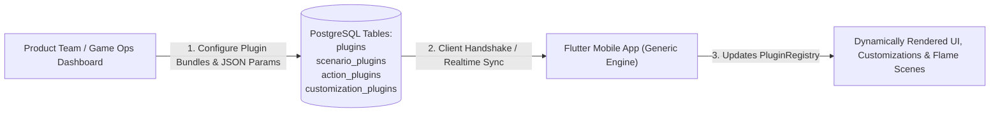

# Plugins: 05 Backend Control & Schemas

This document defines the backend database schemas, remote configuration payloads, and management workflows for orchestrating **Plugin Bundles** (scenarios, user actions, autonomous actions, and customizations like furniture and clothing) in the **Unix Tamagotchi**.

---

## 1. Backend Orchestration Model

The backend acts as the mission control for the generic Flutter plugin engine. Product managers and game operators can:
1. **Create or toggle entire Event/Feature Plugin Bundles** (`plugins` table) or individual items (`scenario_plugins`, `action_plugins`, `customization_plugins`) in PostgreSQL / Supabase.
2. **Schedule limited-time events** by setting `valid_from` and `valid_until` timestamps.
3. **Rebind Scenarios & Furniture Prerequisites**: Point an action to any scenario (e.g. binding `crush_tank` to `hospital_bed`) or require specific room furniture (e.g. requiring `itm_desk` for `destruction_study`).
4. **Ship New Customizations & Events Without Code Changes**: Add new furniture, Kaiju clothing/accessories, room palettes, actions, or scenarios via JSON payloads and remote sprite assets.



---

## 2. PostgreSQL DDL Schema

```sql
-- 0. Parent Plugins Table (Logical bundles for events or feature packs)
CREATE TABLE public.plugins (
    id TEXT PRIMARY KEY,                       -- e.g. 'core_base', 'study_academy_pack', 'military_defense_event'
    display_name TEXT NOT NULL,
    description TEXT,
    is_enabled BOOLEAN NOT NULL DEFAULT true,
    valid_from TIMESTAMPTZ,
    valid_until TIMESTAMPTZ,
    metadata JSONB NOT NULL DEFAULT '{}'::jsonb,
    created_at TIMESTAMPTZ NOT NULL DEFAULT timezone('utc'::text, now()),
    updated_at TIMESTAMPTZ NOT NULL DEFAULT timezone('utc'::text, now())
);

-- 1. Scenario Plugins Table
CREATE TABLE public.scenario_plugins (
    id TEXT PRIMARY KEY,                       -- e.g. 'default_room', 'hospital_bed', 'metropolis_ruins'
    plugin_id TEXT REFERENCES public.plugins(id) ON DELETE CASCADE,
    display_name TEXT NOT NULL,
    is_enabled BOOLEAN NOT NULL DEFAULT true,
    parameters JSONB NOT NULL DEFAULT '{}'::jsonb, -- Layer definitions, kaiju_anchor_point, props
    created_at TIMESTAMPTZ NOT NULL DEFAULT timezone('utc'::text, now()),
    updated_at TIMESTAMPTZ NOT NULL DEFAULT timezone('utc'::text, now())
);

-- 2. Action Plugins Table (User-Triggered, Autonomous, and Minigames)
CREATE TABLE public.action_plugins (
    id TEXT PRIMARY KEY,                       -- e.g. 'eat', 'city_destruction', 'destruction_study'
    plugin_id TEXT REFERENCES public.plugins(id) ON DELETE CASCADE,
    display_name TEXT NOT NULL,                -- User-facing button label
    action_type TEXT NOT NULL CHECK (action_type IN ('USER_TRIGGERED', 'AUTONOMOUS', 'MINIGAME')),
    is_enabled BOOLEAN NOT NULL DEFAULT false, -- Master toggle
    valid_from TIMESTAMPTZ,                    -- Start of seasonal event (nullable = always active)
    valid_until TIMESTAMPTZ,                   -- End of event
    target_scenario_id TEXT REFERENCES public.scenario_plugins(id) ON DELETE SET NULL,
    min_age_phase TEXT DEFAULT NULL CHECK (min_age_phase IN ('baby','child','young','adult','elder')),
    max_age_phase TEXT DEFAULT NULL CHECK (max_age_phase IN ('baby','child','young','adult','elder')),
    -- Furniture items required in the group habitat room to unlock this action (e.g. '["itm_desk"]')
    required_furniture JSONB NOT NULL DEFAULT '[]'::jsonb,
    priority INTEGER NOT NULL DEFAULT 50,
    blocking_conditions JSONB NOT NULL DEFAULT '[]'::jsonb,
    parameters JSONB NOT NULL DEFAULT '{}'::jsonb, -- Dynamic variables (stat deltas, hourly rates, min_energy)
    created_at TIMESTAMPTZ NOT NULL DEFAULT timezone('utc'::text, now()),
    updated_at TIMESTAMPTZ NOT NULL DEFAULT timezone('utc'::text, now())
);

-- 3. Customization Plugins Table (Furniture, Clothing, Skins, Palettes, Boot Messages)
CREATE TABLE public.customization_plugins (
    id TEXT PRIMARY KEY,                       -- e.g. 'itm_desk', 'clothing_mech_visor', 'palette_amber'
    plugin_id TEXT REFERENCES public.plugins(id) ON DELETE CASCADE,
    category TEXT NOT NULL CHECK (category IN ('FURNITURE', 'CLOTHING', 'SKIN', 'PALETTE', 'BOOT_MESSAGE')),
    display_name TEXT NOT NULL,
    price_credits INTEGER NOT NULL DEFAULT 0 CHECK (price_credits >= 0),
    is_enabled BOOLEAN NOT NULL DEFAULT true,
    -- Ensures furniture/items that modify a future stat (e.g. 'intel') are only enabled when that stat is implemented
    required_stat TEXT DEFAULT NULL,
    stat_modifiers JSONB NOT NULL DEFAULT '{}'::jsonb,
    render_data JSONB NOT NULL DEFAULT '{}'::jsonb,
    created_at TIMESTAMPTZ NOT NULL DEFAULT timezone('utc'::text, now()),
    updated_at TIMESTAMPTZ NOT NULL DEFAULT timezone('utc'::text, now())
);

-- Seed Default Plugin Bundles
INSERT INTO public.plugins (id, display_name, is_enabled) VALUES
('core_base',              'Core Habitat & Care Pack',   true),
('study_academy_pack',     'Demolition Academy Pack',    false),
('city_rampage_pack',      'Metropolis Rampage Pack',    false),
('clinic_recovery_pack',   'Containment Clinic Pack',    false),
('military_defense_event', 'Military Defense Event Pack',false);

-- Seed Default Scenarios
INSERT INTO public.scenario_plugins (id, plugin_id, display_name, is_enabled, parameters) VALUES
('default_room',     'core_base',            'Terminal Habitat Room',     true, '{"supports_furniture": true, "ambient_fog": true, "dither_pattern": "bayer4x4"}'::jsonb),
('metropolis_ruins', 'city_rampage_pack',    'Metropolis Ruins',          true, '{"supports_furniture": false, "dither_pattern": "bayer8x8", "skyline_theme": "TOKYO_1954"}'::jsonb),
('hospital_bed',     'clinic_recovery_pack', 'Clinic Recovery Ward',      true, '{"supports_furniture": false, "vital_monitor": true, "iv_drip_level": "FULL"}'::jsonb),
('containment_silo', 'core_base',            'Sub-Zero Containment Silo', true, '{"supports_furniture": false, "radiation_shielding": "MAX", "cryo_temp_k": 77}'::jsonb);

-- Seed Default Actions
INSERT INTO public.action_plugins (id, plugin_id, display_name, action_type, is_enabled, target_scenario_id, min_age_phase, max_age_phase, required_furniture, priority, blocking_conditions, parameters) VALUES
('eat',                'core_base',              'Eat (Ball of Humans)', 'USER_TRIGGERED', true,  'default_room',     NULL,    NULL,    '[]'::jsonb,          50, '[]'::jsonb, '{"hunger_delta": 25, "energy_delta": -5, "happiness_delta": 5}'::jsonb),
('sleep',              'core_base',              'Sleep (Dormancy)',     'USER_TRIGGERED', true,  'default_room',     NULL,    NULL,    '[]'::jsonb,          50, '[]'::jsonb, '{"hunger_delta": -10, "energy_delta": 35, "happiness_delta": 0}'::jsonb),
('play',               'core_base',              'Play (Smash Toys)',    'USER_TRIGGERED', true,  'default_room',     'child', NULL,    '[]'::jsonb,          50, '["is_sick", "is_exhausted"]'::jsonb, '{"hunger_delta": -15, "energy_delta": -20, "happiness_delta": 30, "min_energy": 15}'::jsonb),
('crush_tank',         'military_defense_event', 'Crush Tanks',          'USER_TRIGGERED', false, 'metropolis_ruins', 'young', 'adult', '[]'::jsonb,          60, '["is_sick", "is_exhausted"]'::jsonb, '{"credit_reward": 25, "min_energy": 25, "hunger_delta": -20, "energy_delta": -25, "happiness_delta": 40}'::jsonb),
('destruction_study',  'study_academy_pack',     'Demolition Academy',   'AUTONOMOUS',     false, 'default_room',     'child', 'young', '["itm_desk"]'::jsonb, 40, '["is_sick", "is_exhausted"]'::jsonb, '{"extended_stat_rates_per_hour": {"intel": 5}}'::jsonb),
('advanced_demolition','study_academy_pack',     'Advanced Demolition',  'AUTONOMOUS',     false, 'default_room',     'young', 'young', '["itm_desk"]'::jsonb, 40, '["is_sick", "is_exhausted"]'::jsonb, '{"extended_stat_rates_per_hour": {"intel": 12}}'::jsonb),
('city_destruction',   'city_rampage_pack',      'City Rampage',         'AUTONOMOUS',     false, 'metropolis_ruins', 'young', 'adult', '[]'::jsonb,          50, '["is_sick", "is_exhausted"]'::jsonb, '{"bounty_per_hour": 12, "intel_bounty_scale": 0.01}'::jsonb),
('hospital_recovery',  'clinic_recovery_pack',   'Hospital Recovery',    'AUTONOMOUS',     false, 'hospital_bed',     NULL,    NULL,    '[]'::jsonb,           0, '[]'::jsonb, '{"required_status_flag": "is_sick", "recovery_rate": 5}'::jsonb);
```

---

## 3. Remote Capability Manifest (Client API Response)

When the Flutter app launches, it fetches the active capability manifest from `GET /api/v1/plugins/manifest`:

```json
{
  "timestamp": "2026-09-27T12:00:00.000Z",
  "scenarios": [
    {
      "id": "default_room",
      "display_name": "Default Terminal Room",
      "is_enabled": true,
      "parameters": {
        "dither_matrix": "bayer8x8",
        "ambient_fog": true
      }
    },
    {
      "id": "hospital_bed",
      "display_name": "Clinic Recovery Ward",
      "is_enabled": true,
      "parameters": {
        "vital_monitor": true,
        "iv_drip_level": "FULL"
      }
    }
  ],
  "actions": [
    {
      "id": "eat",
      "display_name": "Eat",
      "action_type": "USER_TRIGGERED",
      "is_enabled": true,
      "target_scenario_id": "default_room",
      "parameters": {
        "hunger_bonus": 25,
        "energy_cost": 5
      }
    },
    {
      "id": "crush_tank",
      "display_name": "Tank Defense Stomp",
      "action_type": "USER_TRIGGERED",
      "is_enabled": true,
      "valid_from": "2026-09-25T00:00:00.000Z",
      "valid_until": "2026-10-05T23:59:59.000Z",
      "target_scenario_id": "hospital_bed",
      "min_age_phase": "young",
      "max_age_phase": "adult",
      "priority": 60,
      "blocking_conditions": [
        { "condition": "is_sick", "blocks": true }
      ],
      "parameters": {
        "credit_reward": 25,
        "min_energy": 20,
        "special_event_title": "Containment Ward Defense Emergency"
      }
    }
  ]
}
```

> [!TIP]
> Notice how in the payload above, the game operator dynamically set `target_scenario_id: "hospital_bed"` for `crush_tank`. The Flutter client will seamlessly execute the tank crushing action while rendering the Kaiju inside the clinic / containment recovery scenario!
