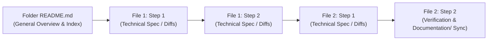

# `agent_prompts/` — Master Guide & Chained Prompt Protocol

> **Workflow**: **AI-First, Human-in-the-Loop**.  
> **Universal Rule**: This file and [`../AGENTS.md`](../AGENTS.md) apply to **every AI model and harness** (Claude Code, Google Antigravity CLI/IDE, Devin, Hermes, Cursor, etc.) that reads or writes code in this repository.

---

## 1. The Golden Rule: `Documentation/` is the Single Source of Truth

At **any moment** that:
- A bug has to be fixed,
- A technical implementation detail differs from what is written in `Documentation/`, or
- A new feature, field, edge case, or adjustment is introduced that was not originally part of the plan,

**the agent MUST update the corresponding specification file(s) inside [`../Documentation/`](../Documentation/README.md) alongside the code change.**

There must always be **one Single Source of Truth (`Documentation/`)**, and the codebase must strictly mirror it. Leaving code changes or bugfixes out of sync with `Documentation/` is forbidden.

---

## 2. Folder Structure of `agent_prompts/`

The `agent_prompts/` directory is divided into milestone/phase folders and feature-specific bugfix folders:

```text
agent_prompts/
├── README.md                          ← You are here (Master Guide & Protocol)
├── PoC/                               ← Milestone 1.1: Initial Offline PoC
│   └── README.md                      ← Entrypoint guide chaining all PoC implementation files
├── Phase-1/                           ← Milestone 1.2: Late Phase 1 (Kaiju Exhaustion & Polish)
│   └── README.md                      ← Entrypoint guide chaining Phase-1 implementation files
├── Phase-2/                           ← Phase 2: Self-Hosted Supabase, Plugin Sync & Base Furniture Store
│   └── README.md                      ← Entrypoint guide chaining Phase-2 implementation files
├── Phase-3/                           ← Phase 3: iOS, Kaiju Aging, Extended Stats + Study Desk, Clinic
│   └── README.md                      ← Entrypoint guide chaining Phase-3 implementation files
├── Phase-4/                           ← Phase 4: Couple & Friends Shared Care + Touch Pairing + IAP
│   └── README.md                      ← Entrypoint guide chaining Phase-4 implementation files
├── Phase-5/                           ← Phase 5+: Minigame Plugins & Late-Stage Permanent Death (ERR_SYS)
│   └── README.md                      ← Entrypoint guide chaining Phase-5 implementation files
├── _templates/                        ← Reusable templates for new phases & Bugfix-<feature-name> folders
│   └── Bugfix-template/
│       ├── README.md                  ← Template entrypoint guide
│       └── 01-technical-fix.md        ← Template technical implementation file with chained steps
└── Bugfix-<feature-name>/             ← Created whenever a specific feature bug or adjustment is needed
    ├── README.md                      ← Explains the issue & points to Step 1 of the first technical file
    └── 01-<fix-details>.md            ← Hardcore technical instructions, diffs, tests, and Doc Sync step
```

---

## 3. How Every Subfolder Works (The Chained Execution Protocol)

Every folder inside `agent_prompts/` (`PoC`, `Phase-1`, `Phase-2`, `Bugfix-<feature-name>`, etc.) **MUST** follow a strict chained structure:

### A. One `README.md` (The Entrypoint Guide)
- Every subfolder contains **exactly one `README.md`**.
- `README.md` provides:
  1. **General Overview**: Plain-language explanation of what needs to be implemented or changed in this phase/bugfix.
  2. **Source of Truth Specs**: Direct links to the `Documentation/<Domain>/` files that govern this work.
  3. **Execution Index**: A numbered list of all technical `.md` files in the folder.
  4. **Entrypoint Directive**: An explicit instruction telling the agent to begin at **Implementation File 1, Step 1** and follow the step-by-step handoff pointers in order.

### B. Technical Implementation `.md` Files (The Chained Steps)
- All other `.md` documents in the subfolder contain the **hardcore technical instructions**: exact file paths, complete code blocks, unified diffs, SQL migrations, GLSL shaders, and verification commands.
- These technical files can have any descriptive name (e.g., `01-theme-and-widgets.md`, `02-dither-shader.md`, `shader-sampler-fix.md`), as long as `README.md` links to all of them.
- **Step-to-Step Handoff Chain**:
  - `README.md` points to **Implementation File 1 → Step 1**.
  - At the bottom of **Implementation File 1 → Step 1**, an explicit handoff block points the agent to **Implementation File 1 → Step 2** (or directly to **Implementation File 2 → Step 1** if File 1 only has one step).
  - At the bottom of the final step of **Implementation File 1**, an explicit handoff block points the agent to **Implementation File 2 → Step 1**, and so on until the end of the chain.
  - **The Final Step of the Final File** in every folder **MUST** be a **Verification & `Documentation/` Sync Step**, instructing the agent to run tests and update `Documentation/` if anything changed or deviated during implementation.



---

## 4. Standard Handoff Syntax Between Steps & Files

When authoring or updating technical `.md` files inside any `agent_prompts/<folder>/`, use the following footer at the end of **every step**:

### Within the Same Implementation File (Step $N$ → Step $N+1$)
```markdown
> **NEXT STEP**: Once the acceptance checks above pass, proceed immediately to **[Step 2: <Step Title>](#step-2-<step-slug>)** in this file.
```

### Across Implementation Files (End of File $A$ → File $B$, Step 1)
```markdown
> **NEXT STEP**: File `01-<name>.md` is complete. Proceed immediately to **[`02-<next-file>.md` — Step 1: <Step Title>](02-<next-file>.md#step-1-<step-slug>)**.
```

### At the End of the Last Step of the Last File in a Folder
```markdown
> **FINAL STEP — DOCUMENTATION SYNC & VERIFICATION**:
> 1. Run all unit/widget/integration tests specified above.
> 2. Compare your implementation against the governing files in `Documentation/`.
> 3. If **anything** was fixed, adjusted, or implemented differently from `Documentation/`, update the corresponding `Documentation/<Domain>/` file(s) now so `Documentation/` remains the Single Source of Truth.
```
